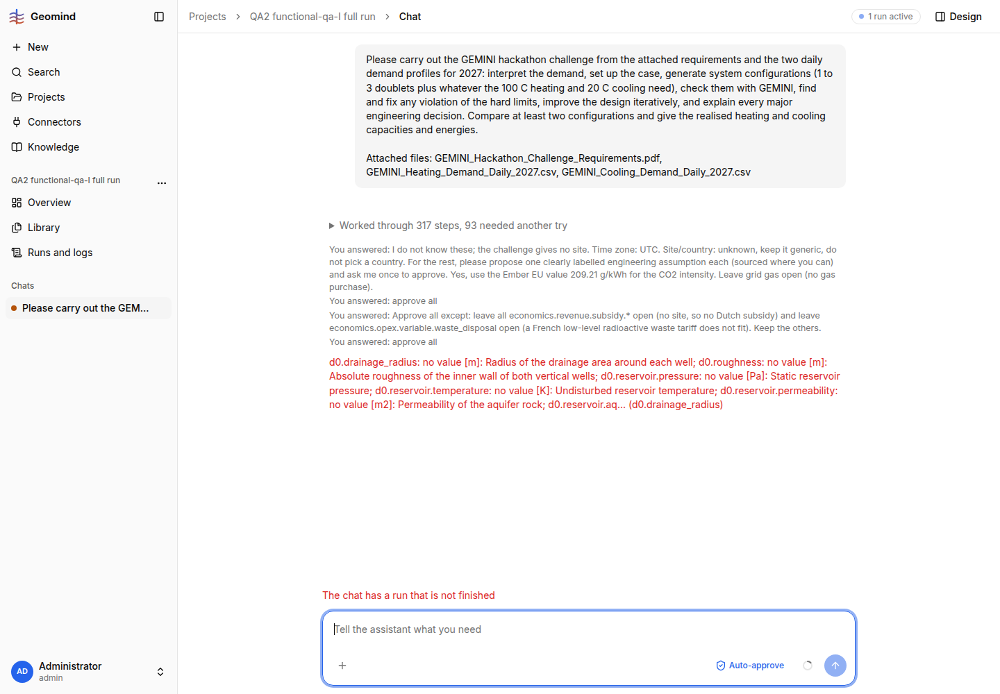

# QA-077: Chat stuck: run shows 'waiting' (run JSON says failed), no Cancel button, new messages refused with 'The chat has a run that is not finished'

| Field | Value |
|---|---|
| Status | open |
| Severity | blocker |
| Area | backend |
| Reporter | functional-qa-I |
| Found | 2026-11-05 04:15 UTC |
| Versions | frontend <x.y.z>, backend <x.y.z> (geomind <x.y.z>) |
| Where | <URL>; project <name/id>; chat <id>; run <id>; step <n> |
| Fixer | |

## Steps

1. 
2. 

## Expected

## Actual

## Evidence

- 
- Run JSON: `../evidence/QA-077/run-<id>.json`

## Cause

(Facts, or a guess marked as one.)

## Fix

(Hotfix session: cause, commit, version, deployed at.)

## Retest

(Who, when, result.)
