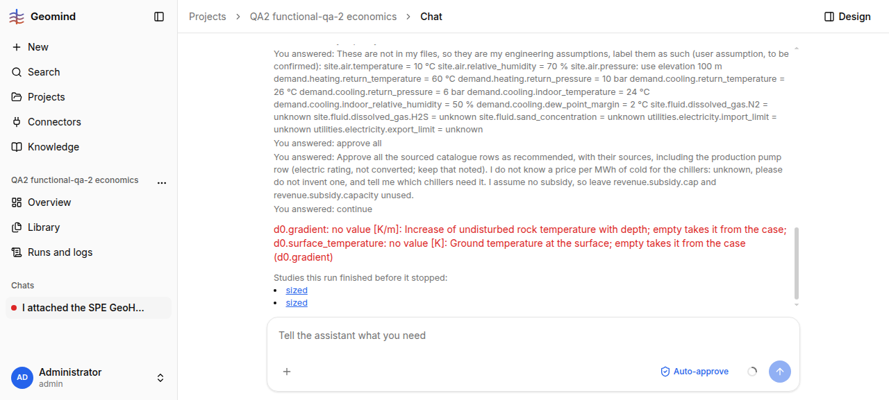

# QA-078: calculate tool corrupts run state (calculations: ids = ['C1']; expected each id once) and the whole run fails

| Field | Value |
|---|---|
| Status | fixed |
| Severity | blocker |
| Area | geomind |
| Reporter | functional-qa-2 |
| Found | 2026-11-05 04:48 UTC |
| Versions | frontend 1.1.71, backend 1.1.69-1.1.71 (geomind 0.4.65, health 1.1.69 at start, 1.1.71 at 04:50) |
| Where | https://geomind.team/projects/aa8023ca-33b3-4e5a-a7ea-5afad6ed4c1e/assistant/chat/f349646d-953b-41c5-a349-09903a5e29c5; project QA2 functional-qa-2 economics; run 6921d00e-f1ba-49e0-9be6-92c85ad4a2c6; design_lead / engineers, `calculate` calls |
| Fixer | hotfix-python |

## Steps

1. New project (shared memory Off), attach the three competition files, Auto-approve on.
2. Chat: build the case, design the integrated plant, simulate, give the full economics.
3. Answer the case-lead questions (assumptions), approve the cost rows, answer "continue" at the 30-step question.
4. The engineers call `calculate` (for example "Half the aquifer thickness": operands case site.reservoir.thickness divided by number 2).

## Expected

`calculate` stores the result under a unique id and the run goes on; a rejected call costs one tool error, not the run.

## Actual

`calculate` returns `update_state: : Value error, calculations: ids = ['C1']; expected each id once` (34 times in the log, from several engineers); a later call even refers to a calculation 'calc-1' that does not exist. After 4.9 M input tokens and ~290 tool calls the run ended `failed` with that same message as the run error, with no plant, no results and no economics (project shows Plant: Not started). The chat shows only "Worked through 1012 steps, 294 needed another try" and the repeated user answers. Agents list also still shows integration_engineer and design_lead as `running` in the failed run.
## Evidence

- 
- Run JSON: `../evidence/QA-078/run-6921d00e.json`, agents `../evidence/QA-078/agents-6921d00e.json`, all `calculate` calls `../evidence/QA-078/calculate-calls-6921d00e.json`

## Cause

Fact: the state validator sees id C1 twice in `calculations`. Guess: `calculate` assigns ids per agent session starting at C1, and two engineers working in parallel on the same state each add their own C1 (needs a global counter or a merge).

## Fix

Cause (code and run_events of 6921d00e): `calculate` and `run_python` numbered ids C1, C2 ... from the problem state they saw. The design lead of that run was itself a rerun after the 04:30 deploy (QA-070) and its calculations, made at once and in nested runs holding their own copy of the state, both took C1 (seq 1823) and C3 (1875); from then on every state change of the run failed the id check, and the run ended failed at seq 2076. Fix: ids are random, `C` and six hex digits, never read from the state; a stored state with a repeated calculation or finding id loads again, keeping the first, so a corrupted chat recovers. geomind 0.4.68 (commit 21e4fb1, release 47259b8, tag v0.4.68), backend 1.1.72 (8722a33), deployed 2026-11-05 05:00 UTC by hotfix-python-II.

## Retest

functional-qa-2, 2026-11-05 09:30 UTC, backend 1.1.79 (geomind with random ids): NOT RETESTED FULLY. In run cef908d9 (2 h 40 and 575 steps) `calculate` was used only once and without error, so the original failure (parallel engineers each adding C1) was not provoked again. The same duplicate-id validator fired twice on a different list: `update_state: questions: ids = ['Q-indoor']; expected each id once` (events of run cef908d9, case_lead/design_lead); the run recovered and went on. Suggest the same random-id fix for the `questions` list and a retest with several engineers using `calculate`.
