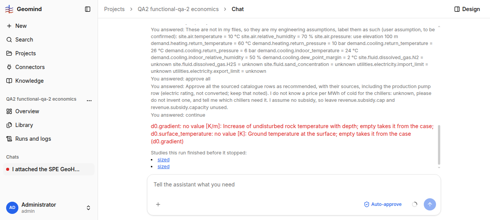

# QA-079: The same case and cost questions are asked three times in one run although the user answered each time

| Field | Value |
|---|---|
| Status | open |
| Severity | major |
| Area | geomind |
| Reporter | functional-qa-2 |
| Found | 2026-11-05 04:49 UTC |
| Versions | frontend <x.y.z>, backend <x.y.z> (geomind <x.y.z>) |
| Where | <URL>; project <name/id>; chat <id>; run <id>; step <n> |
| Fixer | |

## Steps

1. 
2. 

## Expected

## Actual

## Evidence

- 
- Run JSON: `../evidence/QA-079/run-<id>.json`

## Cause

(Facts, or a guess marked as one.)

## Fix

(Hotfix session: cause, commit, version, deployed at.)

## Retest

(Who, when, result.)
