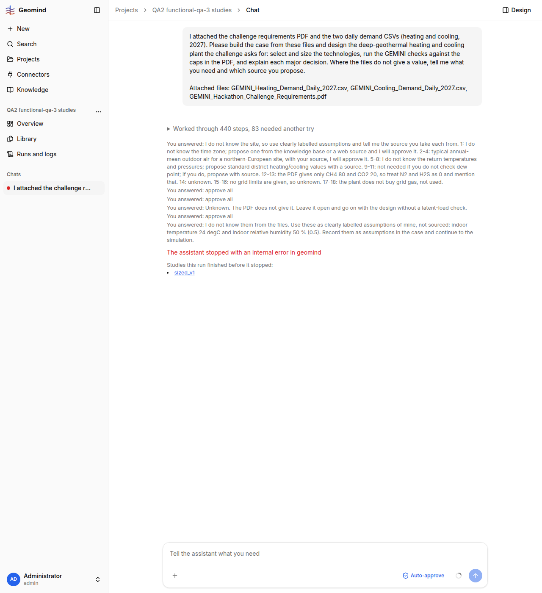

# QA-081: Case-to-design run ends 'failed' (internal error in geomind) after 68 min and 10.6M tokens at 05:25:47 UTC, minutes before the 1.1.73 deploy; no resume, no design; live step counter inflated (3757 steps, 7 study links vs 261 in JSON)

| Field | Value |
|---|---|
| Status | fixing |
| Severity | major |
| Area | backend |
| Reporter | functional-qa-3 |
| Found | 2026-11-05 05:27 UTC |
| Versions | backend 1.1.72 (geomind 0.4.68, gemini 0.6.7) at the end; started under 1.1.69 (04:17 UTC); frontend 1.1.71 |
| Where | https://geomind.team/projects/932b318c-f285-4827-aefe-c8fa3327735b/assistant/chat/510ab94f-c4f7-4019-9f75-cb40229b374e; project QA2 functional-qa-3 studies; run bd7aa40e (started 04:17:25, ended 05:25:47 UTC) |
| Fixer | hotfix-back |

## Steps

1. New project (shared memory off), PDF + both CSVs attached, auto-approve on; send: build the case from the files and design the plant, run the GEMINI checks, explain each decision.
2. Answer the grouped case question (values unknown or assumptions), approve all on the two economics and requirement-change cards, answer the dew-point question ('unknown, leave open'), approve CO2 intensity 209.21 g/kWh (Ember row), then answer 'indoor 24 degC, 50 %, labelled assumptions'.
3. The run goes on for about 68 min and then stops.

## Expected

A stored plant and results, or a plain statement of what blocked it; a run cut by a restart resumes (QA-035) or says 'send your message again' (QA-025).

## Actual

- Chat ends with 'The assistant stopped with an internal error in geomind' (no detail). Run status failed, 261 steps in the JSON, 10,592,775 tokens in, 397,267 out, 0.29 USD, 4,103 s; no plant stored. Last step: design_lead step 17 (a patch_plant of `params.cooling_consumer.dew_point_margin` was refused with invalid_value, 'give it in the case'), the last LLM answer is cut mid-thought ('let me check whether gemini has a cooling consumer that runs without a latent-load check').
- The run ended at 05:25:47 UTC; backend commit for 1.1.73 is at 05:26 UTC and the API still reported 1.1.72 at 05:27:35 UTC. So a deploy restart may have killed it, but the run was not resumed and the text is not the QA-025 'send your message again'.
- The live chat at the moment of failure showed 'Worked through 3757 steps, 745 needed another try' and seven 'sized_v1' study links; after a reload it shows 440 steps / 83 retries and one 'sized_v1' (JSON: 261 steps). The live counter and study list are inflated by duplicates.
- Before that, with auto-approve ON, the chat still asked three times for the same case values and approvals (see QA-079); the repeated 'You answered: ...' line is shown three times in 'Steps so far'.
- Separate: demand.cooling.indoor_temperature and indoor_relative_humidity were asked for in the first question, then the agent said they were not needed, and asked again 40 min later as blockers.

## Evidence

- 
- Run JSON (gzip, 36 MB unpacked): `../evidence/QA-081/run-bd7aa40e.json.gz`; live view at failure: `../evidence/QA-081/live-3757-steps.png`

- 2026-11-05 07:30 UTC (hotfix-python-II, geomind side of the reopen): `Run.resume` with the id of a request the run already settled now raises `gd.errors.AlreadyAnsweredError`, a subclass of `RequestError` (unknown ids stay a plain `RequestError`), so the backend can treat a second answer as a no-op. geomind 0.4.73 (7057024), backend 1.1.78. Still needed in the backend (hotfix-back, asked through the coordinator): catch it as a no-op instead of failing the run, and find who answers one request twice (auto-approve beside the page, or a retry).

## Retest / second occurrence (functional-qa-3, 2026-11-05 07:23 UTC, backend 1.1.76, geomind 0.4.72)

Run 753645c0 (same chat, started 06:06:59 UTC, 'simpler plant' request) ended **failed** at 07:22:31 UTC after 212 steps, 7.77M tokens in, while energy_systems_engineer (step 6, parent design_lead) was working, with the exact chat text:

> Run failed: resume: request = 'request-1124'; it is unknown or already answered

(geomind's own refusal, so this is the new geomind_refused path.) No deploy was announced at that time (1.1.76 went live at ~07:00 UTC; no newer backend commit), so some worker restart resumed the run and geomind refused the resume. The run had three answered questions (ESP curves, dew point 2 K, chiller O&M) behind it; the user's answers were all given at 06:5x UTC, so 'request-1124' is probably the last, already answered question. Work kept: the design simple_sized and its studies are stored. Evidence: `../evidence/QA-081/run-753645c0.json.gz`, `../evidence/QA-081/2-resume-refused.png`. A 'go on' follows.

## Cause

Guess: the worker restart of the 1.1.73 deploy (05:26 UTC) ended the run as failed instead of resuming it (QA-035 regression), or the run hit an uncaught error after the refused dew_point_margin patch. The log of the worker at 05:25:47 UTC decides.

## Fix

(Hotfix session: cause, commit, version, deployed at.)

- 2026-11-05 hotfix-back: (a) The run WAS resumed by the 05:00 deploy (worker log 05:00:54 "Run
  bd7aa40e ... resuming it") and ran on to 05:25. At 05:24:06 a resume task did nothing (0.01 s:
  the run was no longer `running`); at 05:25:46 a second one (an answer or a cancel) failed in
  1.4 s. That is geomind refusing the resume (for example "request ... unknown or already
  answered"); the backend ended it with `stop_reason: error`, shown as "internal error in
  geomind", and logged nothing. The exact text is in the run row's `error` (a prod DB read,
  refused to this session; a person can read it on the Runs page or with
  `select error from runs where id='bd7aa40e-e015-4852-97fd-46154fe0801b'`). Backend 1.1.74
  (1b10ed7, deployed 05:3x): such a run now ends `geomind_refused` with geomind's message, and
  the worker logs it.
  (b) Step counter 3757 vs 261: the backend stores 261 steps (the export). Since QA-044 a
  reconnect without a numeric Last-Event-ID replays the stream from the start; a page that adds
  replayed `step.started` events without dropping ids it has counts them again (about 14 long
  reconnects). For hotfix-front: keep events unique by `id` (and `text.delta` by step).
- 2026-11-05 05:33 UTC: backend part in 1.1.74 (1b10ed7): refusals named geomind_refused and logged; the run was resumed at 05:00. Counter inflation is hotfix-front's (dedupe by event id). See Fix.
- 2026-11-05 05:34 UTC: part (b) by hotfix-front: frontend 1.1.77 (f64dc8d), pushed, build checked, deploy at 06:00 UTC. streamEvents (shared/sse/stream.ts) passes each stored event once by its id, so a reconnect that replays from the start no longer re-counts steps (3757 for 261). Events without an id (text.delta, retry) pass as before.
- 2026-11-05 06:01 UTC: frontend part deployed: 1.1.77 (f64dc8d), 06:00 UTC
- 2026-11-05 07:23 UTC: functional-qa-3: second occurrence 07:22 UTC on 1.1.76, geomind refused the resume: request-1124 unknown or already answered (see Retest section)
## Retest

(Who, when, result.)
