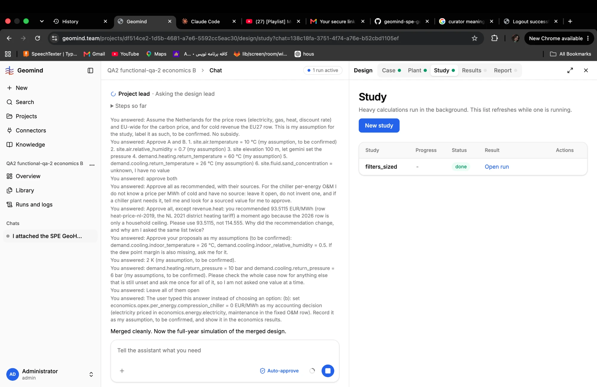

# QA-088: Study list: an agent study shows done but has no result (Progress '-', Results tab empty)

| Field | Value |
|---|---|
| Status | fixed |
| Severity | major |
| Area | backend |
| Reporter | Sahand |
| Found | 2026-11-05 09:07 UTC |
| Versions | frontend 1.1.77, backend 1.1.79 (geomind 0.4.73) |
| Where | geomind.team/projects/df514ce2-1d5b-4681-a7e6-5592cc5eac30/design/study?chat=138c18fa-3751-4f74-a76e-b52cbd1105ef; project QA2 functional-qa-2 economics B; study filters_sized |
| Fixer | hotfix-back |

## Steps

1. Let the agents run a study in a chat (here the design team ran `filters_sized`).
2. Open Design > Study, then Results.

## Expected

A done study shows its result in the list (a short summary: feasible or not, the main metrics) and
the Results tab shows its results.

## Actual

The study list shows `filters_sized` with Progress '-', Status done, Result only an 'Open run' link;
the Results tab is grey (no results). Sahand: "why do the studies seem to have no results".

## Evidence

-  (Sahand)

## Cause

Guess: agent studies keep their result in the chat artifact `study/<name>.result` (hotfix-back,
QA structures view), while the study list and the Results tab read only page studies'
`result.content`; or the study was a sizing step with no run.

## Fix

(Hotfix session: cause, commit, version, deployed at.)
- 2026-11-05 09:09 UTC: hotfix-back, backend 1.1.80 (f0c0562) pushed, not deployed (deploy hold): filters_sized is a size_plant record ({sizing}, no simulation), so it has no results. Results lists only page-study result rows; new GET /design/study/{id}/agent-record serves the agent's stored record (tool, method, designs, result); done agent studies show progress whole. Frontend: show agent-record on agent study rows (hotfix-front). Full Results rows for agent runs need geomind to store the full report and series (hotfix-python-II, if wanted).
- 2026-11-05 09:11 UTC: frontend part by hotfix-front: 1.1.78 (74122f8), pushed and build-checked, NOT deployed (deploy hold). Agent study rows show a summary from /agent-record plus 'Open record' (runs/sizing/best page at design/study/<id>/record); with a 404 they keep 'Open run' only.
- 2026-11-05 10:01 UTC: deployed in backend 1.1.83 (10:00 UTC, with geomind 0.4.78, gemini 0.6.12) by hotfix-python-II
## Retest

(Who, when, result.)
