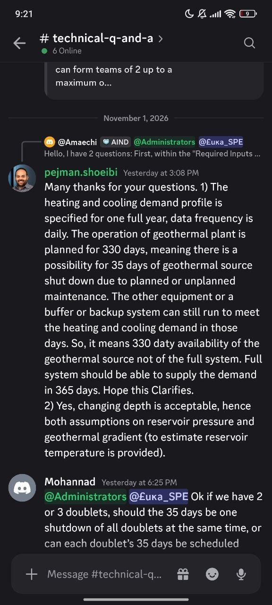

# QA-091: Case lead writes the 100 C / 20 C supply temperatures as exact requirements checked 'always'; a zero-cooling day fails the plant

| Field | Value |
|---|---|
| Status | fixing |
| Severity | major |
| Area | geomind |
| Reporter | Fatemeh (asked), Claude (DB read and write-up) |
| Found | 2026-11-05 09:25 UTC |
| Versions | backend 1.1.78 (geomind 0.4.73, gemini 0.6.10) |
| Where | project 61134432-45fa-48db-afef-4f930f3825da (QA2 functional-qa-I full run), chat cb8b9b2d-edce-4f69-9dfb-6b015a821601, run 3bdd7ebb-3fc2-4942-b5e9-030ee588c036 (running since 07:02 UTC) |
| Fixer | hotfix-python |

## Steps

1. Ask for the hackathon challenge from the PDF and the two 2027 demand CSVs (functional-qa-I's full run).
2. The case lead turns the brief's "Heating supply temperature 100 °C, Fixed" and "Cooling supply temperature 20 °C, Fixed" into requirements.
3. The design team simulates family A (compression chiller) for the whole of 2027 and checks it.

## Expected

The requirements follow the brief as gemini's own sample reads it (`gemini/examples/hackathon_2026`,
README "Requirements of the case"): 100 °C and 20 °C are fixed operating conditions of the plant;
the check is that the heat and cold demand are met (`heat_delivered`, `cold_delivered`: `unmet_share`
at most 0.01), and every per-step limit applies `when: running`. A day with zero cooling demand does
not fail the plant.

## Actual

Case version 10 of the project has:
`{"name": "cooling_supply_temperature", "on": "cooling_supply", "quantity": "temperature", "min": 20, "max": 20, "unit": "°C", "over": "each", "when": "always"}`
(and the same for heating at 100 °C). All the other requirements are `when: running`.
On zero-cooling-demand days (2027-01-01, 2027-04-19) the chiller is not dispatched and the idle
chilled-water loop sits at the CoolingGrid's 25 °C return, so `check_results` returns
`feasible: false` with one reason, cooling_supply_temperature 25.0 °C. Family A passes the other
8 of 9 limits (result/3fc37eb6fdb9a22b). The design team has spent three rounds (about 07:56 to
09:20 UTC) on it: minimum_part_load, a Splitter/Mixer/CirculationPump bypass (does not converge,
overcools to 10 °C), dispatch 'always_on' (refused). The run is in its fourth round.

## Evidence

- Postgres read-only: case_versions of project 61134432 (number 10, requirements); run_events of
  run 3bdd7ebb (simulate at sequence 4351, design lead's summary at 4528, project lead's new task at 4542).
- gemini/examples/hackathon_2026/README.md lines 59-60 and the requirements table.
- Organisers' answer (Discord #technical-q-and-a, pejman.shoeibi, 2026-11-04 15:08, to Amaechi): "330 days availability of the geothermal source not of the full system. Full system should be able to supply the demand in 365 days." So heat/cold delivered over all 365 days is a requirement of the brief; the 330 days limit only the doublet. 

## Cause

Guess: the case lead's prompt maps a "Fixed" supply temperature to an exact temperature requirement
over every step with `when: always`. Decision for the coordinator / Sahand against the project's
requirements: drop the two temperature requirements in favour of heat/cold delivered (as the gemini
sample does), or keep them with `when: running`. No change to gemini is needed for either.

## Fix

hotfix-python-III, 2026-11-05, geomind 0.4.79 (tag v0.4.79), backend 1.1.84 (deploy 10:30 UTC).
Cause: the case lead wrote the brief's "Fixed" supply temperatures as per-step requirements
`when: always`; on zero-demand days the supply runs no flow and the idle loop sits at its return
(25 C cooling), so `always` failed the plant. gemini's `running` (the module carried flow) is the
right reading: no gemini change.
- geomind 369b2f3: `set_case` turns a per-step `temperature` requirement on a `*_supply` role with
  `when` `always` or none into `when: running`, and lists it in `converted` with the reason.
- geomind 4e30728: the case lead writes fixed supply temperatures `when: running` and adds
  `heat_delivered` / `cold_delivered` (`unmet_share` <= 0.01, an assumption) as gemini's sample
  does, judged over the whole simulated year (330 d is the doublet's availability, not the
  system's; organisers, Discord 2026-11-04 15:08).
Project 61134432, case version 10: the next `set_case` of any kind on that project (for example
the user asking "fix the supply temperature rules", or "add heat and cold delivered requirements")
rewrites both rules to `running` and the case lead adds the delivered-energy rules; no manual DB
edit. QA-090 is the same failure seen from the design loop; its stop rule is in QA-090.

## Retest
