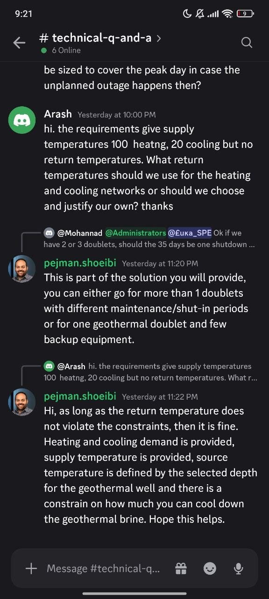

# QA-094: Return temperatures are treated as case values that need a source; the organisers say they are the team's design choice within the constraints

| Field | Value |
|---|---|
| Status | fixing |
| Severity | major |
| Area | geomind |
| Reporter | Fatemeh (organisers' answers), Claude (write-up) |
| Found | 2026-11-05 09:27 UTC |
| Versions | backend 1.1.78 (geomind 0.4.73), or later |
| Where | every challenge case; seen in chats 33c76f29 and cb8b9b2d |
| Fixer | hotfix-python |

## Steps

1. A design chat on the challenge files (the brief gives supply temperatures 100 °C and 20 °C, no return temperatures).
2. The case lead and the design team need the heating and cooling return temperatures.

## Expected

The organisers' answer (Discord #technical-q-and-a, pejman.shoeibi, 2026-11-03 23:22, to Arash): "as long as the return temperature does not violate the constraints, then it is fine. Heating and cooling demand is provided, supply temperature is provided, source temperature is defined by the selected depth ... and there is a constraint on how much you can cool down the geothermal brine." So the return temperatures are the team's design choice: the design team picks them, gives a reason, and gemini's check (brine cooling 40 K, demand met) decides.

## Actual

geomind treats them as case values with no source: `prompts/design/energy.md:65` "a return temperature the case lacks is a case change, never a typical value". The agents asked the user for them again and again and stopped the design without them (QA-009, QA-010, QA-015; chat 33c76f29 "six case values ... the design still cannot be sized").

## Evidence

- 
- `geomind/geomind/prompts/design/energy.md` line 65; `prompts/case/lead.md` line 84 (depth, units, backup are design freedoms; return temperatures are not listed).

## Cause

Fact: the prompts put the return temperature with the case. Proposal: list the network return temperatures with the design freedoms (like depth and backup): the design team chooses them as a recorded design assumption with its reason, within the constraints, and the user sees them in the report.

## Fix

hotfix-python-III, 2026-11-05, geomind 0.4.79 (tag v0.4.79, commit 0614dfe), backend 1.1.84
(deploy 10:30 UTC). gemini's case still needs `demand.*.return_temperature`, so the value stays in
the case, but as a design choice, not a missing value: the case lead proposes it in the one
question as `<path> = <value> | design choice, the brief leaves it to the team | <reason>` and
records it `source: agent`, `reason: design choice, approved by the user`, citation `design
choice`; it never asks the user to supply it nor stops for it. `prompts/design/energy.md` and the
`designing-a-plant` skill: the design team proposes a return temperature with its reason within
the case's limits (brine cooling, demand met) and never stops the design to wait for one.

## Retest
