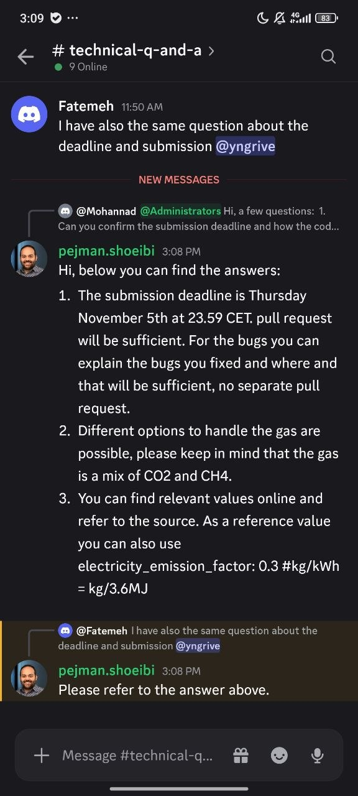

# QA-095: Grid CO2 intensity: the knowledge base has only Ember EU 209 g/kWh; the organisers' reference value 0.3 kg/kWh is missing

| Field | Value |
|---|---|
| Status | fixed |
| Severity | major |
| Area | data |
| Reporter | Fatemeh (organisers' answers), Claude (write-up) |
| Found | 2026-11-05 09:28 UTC |
| Versions | backend 1.1.78 (geomind 0.4.73), or later |
| Where | every challenge case; seen in chats 33c76f29 and cb8b9b2d |
| Fixer | hotfix-back-II |

## Steps

1. A case for the challenge; the case lead sets utilities.electricity.co2_intensity.

## Expected

The organisers' reference value is offered first (Discord #technical-q-and-a, pejman.shoeibi, 2026-11-04 15:08: "You can find relevant values online and refer to the source. As a reference value you can also use electricity_emission_factor: 0.3 #kg/kWh"), with the Ember row as the alternative.

## Actual

`geomind/data/knowledge/cost-sources.csv` has only `co2-grid-eu-2025` (209.21 g/kWh) and `co2-grid-eu-2024` (211.52 g/kWh). Every case so far took 209.21 g/kWh (assumption A1), about 30 % below the organisers' reference, so the CO2 results are not on the organisers' basis.

## Evidence

- 
- `grep co2-grid geomind/data/knowledge/cost-sources.csv`

## Cause

Fact: no knowledge row holds the organisers' value. Fix (data): add a row `co2-grid-organisers-2026`, 300 g/kWh, source "GEMINI hackathon organisers, Discord #technical-q-and-a, 2026-11-04", status verified, path utilities.electricity.co2_intensity, and make the case lead recommend it for this challenge.

## Fix

hotfix-back-II, 2026-11-05 09:35 UTC: geomind `main` commit 3a5027d adds the knowledge row
`co2-grid-organisers-2026` (300 g/kWh, path utilities.electricity.co2_intensity, status verified,
source: GEMINI GeoHackathon 2026 organisers, Discord #technical-q-and-a, 2026-11-04 15:08, quote in
the row) with the note "Recommended for the GEMINI GeoHackathon 2026 cases"; Ember stays the
alternative. Data only, not yet live. Still owed:
1. a geomind release with the row (hotfix-python-II, on Sahand's word) and a backend deploy;
2. the Knowledge re-seed with the new catalogue (Sahand; same command as 2026-11-04 23:35 UTC);
3. the case lead offering this row first for challenge cases (prompt or skill: hotfix-python-II).
- 2026-11-05 14:11 UTC: row co2-grid-organisers-2026 live: cost-sources.csv/md (110734/11260 bytes, = geomind main) re-uploaded to Knowledge 10:18 UTC, ready; case lead recommends it (geomind 0.4.79+)
## Retest
