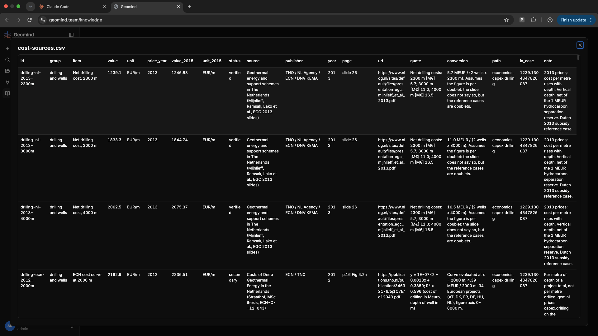
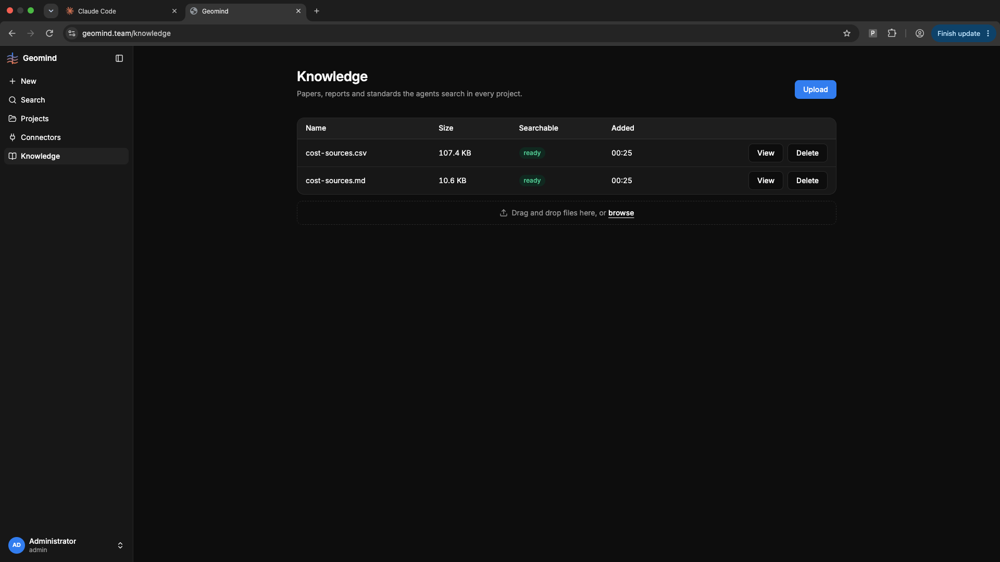

# QA-096: Knowledge CSV view: every cell wraps its full text, rows are huge and columns too wide

| Field | Value |
|---|---|
| Status | open |
| Severity | minor |
| Area | frontend |
| Reporter | user via coordinator |
| Found | 2026-11-05 09:39 UTC |
| Versions | frontend 1.1.77 |
| Where | https://geomind.team/knowledge, View of cost-sources.csv |
| Fixer | |

## Steps

1. Open Knowledge, click View on cost-sources.csv.
2. Look at the table.

## Expected

1. Fixed compact row height: cell text on one line, cut with an ellipsis; a single cell can be expanded (click the cell: popover with the full text).
2. Columns have a capped width; no column grows to fit long text.
3. The header row stays at the top while scrolling down.
4. Horizontal scrolling when there are many columns.

Stock shadcn components.

## Actual

Every cell wraps its full text, so rows are very tall (source, quote, conversion, note) and columns are too wide; few rows fit on screen.

## Evidence

- 
- 

## Cause

(Facts, or a guess marked as one.)

## Fix

(Hotfix session: cause, commit, version, deployed at.)

## Retest

(Who, when, result.)
