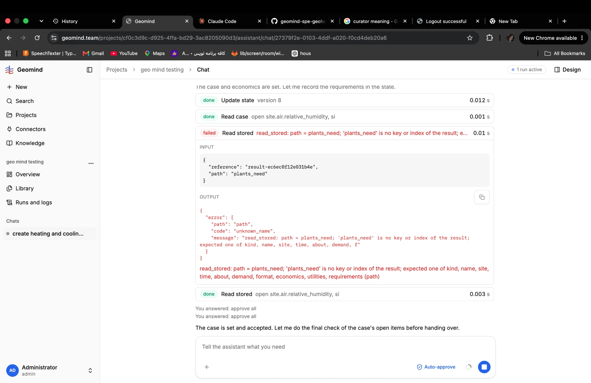

# QA-097: Case lead reads plants_need from the set_case result with read_stored; the stored result has no plants_need key

| Field | Value |
|---|---|
| Status | open |
| Severity | minor |
| Area | geomind |
| Reporter | Fatemeh (screenshot), Claude (write-up) |
| Found | 2026-11-05 10:17 UTC |
| Versions | backend 1.1.83 |
| Where | https://geomind.team/projects/cf0c3d9c-d925-4ffa-bd29-3ac8205090d3/assistant/chat/27379f2e-0103-4ddf-a020-f0cd4deb20a6 (project geo mind testing) |
| Fixer | |

## Steps

1. The case lead sets the case and records the requirements (state version 8).
2. It checks the case's open items before handing over.

## Expected

The case lead reads what the plants still need where set_case puts it (QA-069: set_case returns `plants_need`).

## Actual

`read_stored(reference="result-ec6ec0f12e031b4e", path="plants_need")` fails: "'plants_need' is no key or index of the result; expected one of kind, name, site, time, about, demand, format, economics, utilities, requirements". The stored result is the case itself, not set_case's answer. The next call (read_stored without that path) works and shows "open site.air.relative_humidity, ...". One wasted call and a red "failed" row in the chat.

## Evidence

- 

## Cause

Guess: set_case's answer carries `plants_need` inline, but the stored result referenced in it holds only the case; the prompt (or the answer's wording) leads the agent to read `plants_need` from the stored case.

## Fix

## Retest
