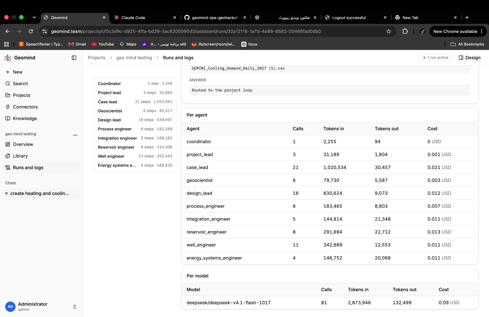

# QA-100: Runs and logs: the section titles Per agent and Per model are the size and weight of the column headers; they do not read as titles

| Field | Value |
|---|---|
| Status | fixed |
| Severity | cosmetic |
| Area | frontend |
| Reporter | Fatemeh (screenshot), Claude (write-up) |
| Found | 2026-11-05 10:36 UTC |
| Versions | frontend as deployed 2026-11-05 ~10:30 UTC |
| Where | https://geomind.team/projects/cf0c3d9c-d925-4ffa-bd29-3ac8205090d3/assistant/runs/32a12115-1a7d-4e89-8582-05466fad0db0 |
| Fixer | hotfix-front-III |

## Steps

1. Open Runs and logs and a run; scroll to the totals.

## Expected

"Per agent" and "Per model" read as section titles, like the card titles elsewhere in the app (larger or bolder than the table's column headers).

## Actual

The titles are the table's caption (`TableCaption`, `font-medium`, the default small size), the same size and weight as the column headers (Agent, Calls, Tokens in ...), so they look like one more header row. Fatemeh: "aren't these titles very small?"

## Evidence

- 
- `frontend/src/domains/assistant/runs/totals-table.tsx` line 19.

## Cause

Fact: the caption has no size of its own. Fix: a section title above each table (as the other cards use), or `text-base font-semibold` on the caption.

## Fix

hotfix-front-III, frontend 1.1.95 (d699ece): the caption is `text-base font-semibold`. Deploy 11:30 UTC.
- 2026-11-05 14:11 UTC: frontend 1.1.99 (e9435c4) deployed 14:10 UTC, bundle index-BlepNtQt.js
## Retest
