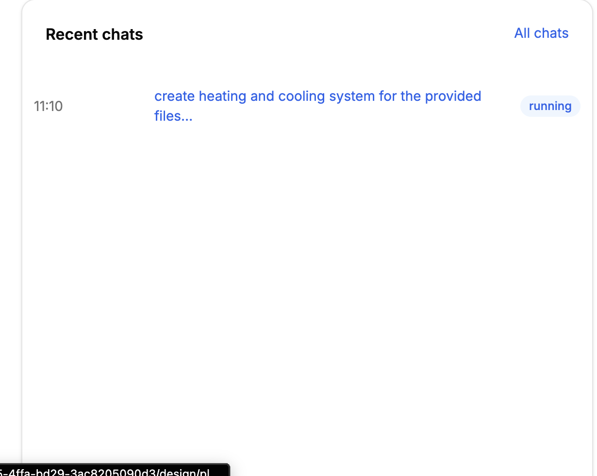

# QA-101: Overview, Recent chats: rows do not line up with the card, a wide empty time column, the running badge touches the card edge, a tall empty card

| Field | Value |
|---|---|
| Status | fixed |
| Severity | cosmetic |
| Area | frontend |
| Reporter | Fatemeh (screenshot), Claude (write-up) |
| Found | 2026-11-05 10:38 UTC |
| Versions | frontend as deployed 2026-11-05 ~10:40 UTC |
| Where | Overview of project cf0c3d9c-d925-4ffa-bd29-3ac8205090d3 (geo mind testing), card Recent chats |
| Fixer | hotfix-front-III |

## Steps

1. Open a project's Overview with one chat that has a running run.

## Expected

The rows line up with the card's title, the time takes only the room it needs, the title stays on one line (cut with an ellipsis, full text on hover), the badge sits inside the card's padding, and the card is as tall as its rows.

## Actual

- The row starts left of the "Recent chats" title: the rows use `px-3`, the card header a larger padding.
- The time column is `w-28` for a date and time label, but today's label is only "11:10", so a wide gap separates it from the title.
- The title wraps to two lines.
- The "running" badge reaches the card's right edge (no shrink-0, row padding smaller than the header's).
- The card stretches to the height of its grid row, so one chat sits on a tall empty card.
Fatemeh: "this is ugly".

## Evidence

- 
- `frontend/src/domains/workspace/overview/recent-chats.tsx` lines 26-35.

## Cause

Fact (code): `li` has `px-3` while CardHeader has its own padding; the time span is `w-28 flex-none`; the link has `flex-1` with no `truncate`/`min-w-0`; the Badge has no `flex-none`. Guess: the overview grid stretches the card (`items-stretch`).

## Fix

hotfix-front-III, frontend 1.1.96 (16c45af): the list is a grid with subgrid rows (`auto | 1fr | auto`), so the time column is as wide as its longest label and titles line up; rows use the header's `px-6`; the title truncates with the full text on hover; the badge sits in its own column; the card is `self-start`. Deploy 11:30 UTC.
- 2026-11-05 14:11 UTC: frontend 1.1.99 (e9435c4) deployed 14:10 UTC, bundle index-BlepNtQt.js
## Retest
