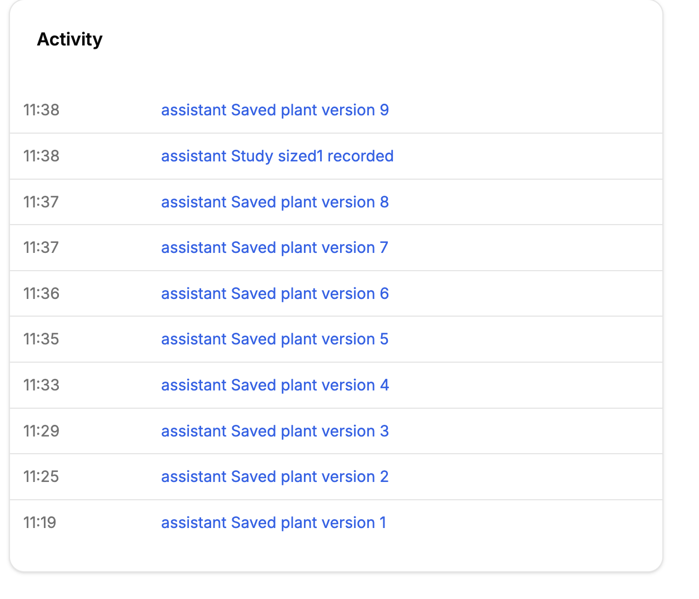
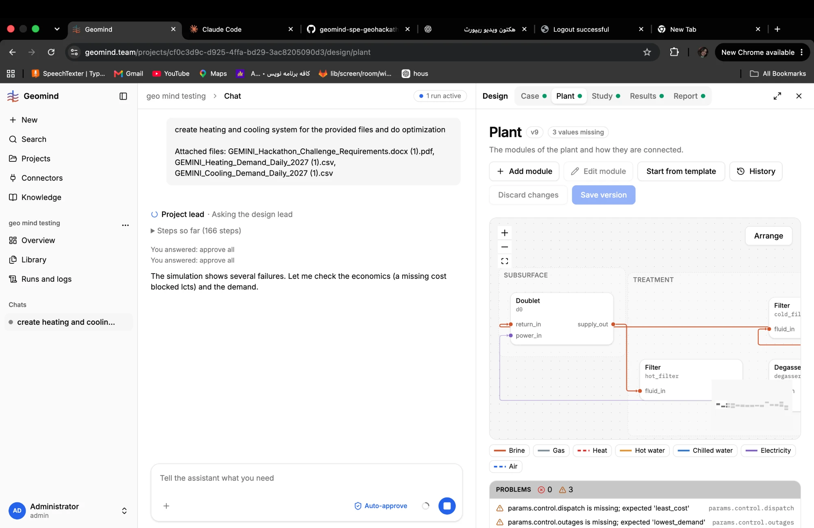

# QA-102: Overview Activity: every row opens the current Plant page; a plant or case version links to no version, a study link has no route

| Field | Value |
|---|---|
| Status | fixing |
| Severity | minor |
| Area | frontend |
| Reporter | Fatemeh (screenshots), Claude (DB read and write-up) |
| Found | 2026-11-05 10:39 UTC |
| Versions | frontend and backend as deployed 2026-11-05 ~10:45 UTC |
| Where | Overview of project cf0c3d9c-d925-4ffa-bd29-3ac8205090d3 (geo mind testing), card Activity |
| Fixer | hotfix-front-III |

## Steps

1. Open the project's Overview; the Activity card lists "assistant Saved plant version 1" ... "9" and "assistant Study sized1 recorded".
2. Click any row.

## Expected

Each row opens what it names: "Saved plant version 3" opens version 3 (the Plant page's History on that version, or a diff); "Study sized1 recorded" opens that study.

## Actual

Every row opens the current Plant page (v9), whatever it names.

## Evidence

- 
- 
- Postgres read-only, table `activity` (all projects): `design/case` 130 rows, 0 with a link_id; `design/plant` 59 rows, 0 with a link_id; `design/study` 29 rows, 15 with a link_id; `design/report` 12, 0. For this project: "Saved plant version 9" -> route design/plant, link_id NULL; "Study sized1 recorded" -> design/study, link_id c3ea54d3-3f7d-41ec-a98f-4e330e0a1caf.
- `frontend/src/domains/workspace/overview/link.ts`: the path is `/projects/<id>/<route>/<link_id>`. `frontend/src/domains/design/routes.ts` has `design/study/:studyId/record` and `/structures` but no `design/study/:studyId`, and no plant or case version route.

## Cause

Fact: the backend writes plant and case activity with no version id, and the frontend has no route for a version or for a bare study id. Fix: write the version number (and the study id) into the link, and route `design/plant?version=N` / `design/case?version=N` to History on that version, and `design/study/<id>` to the study's record. Also: the row text starts with the lowercase actor ("assistant Saved plant ..."); "Assistant saved plant version 9" reads better.

## Fix

hotfix-back-II, 2026-11-05 11:05 UTC, backend part: backend 1.1.87 (49d587b) writes the version
number as `link.id` on new "Saved case/plant version N" rows (assistant and user); study rows
already carry the study id. Older rows stay without an id. Deploy 11:30 UTC. Still owed
(frontend, hotfix-front-III): route design/case and design/plant with id N to History on version
N, design/study/<id> to the study; sentence-case actor.
- 2026-11-05 11:05 UTC: backend part done in 1.1.87 (11:30 UTC); frontend part for hotfix-front-III

hotfix-front-III, frontend part 1.1.99 (e9435c4): `overview/link.ts` sends a case or plant row with an id to `design/case?version=N` / `design/plant?version=N`, which open History on version N (closing it drops the parameter); a study row with an id opens `design/study/<id>/record`; rows are sentence case ("Assistant saved plant version 3"). Deploy 11:30 UTC.

## Retest
