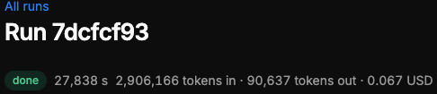

# QA-103: Runs and logs: durations in raw seconds and token counts in full digits (27,838 s · 2,906,166 tokens in)

| Field | Value |
|---|---|
| Status | verified |
| Severity | minor |
| Area | frontend |
| Reporter | user via coordinator |
| Found | 2026-11-05 10:40 UTC |
| Versions | frontend 1.1.86 |
| Where | Runs and logs, run 7dcfcf93 (project sahand test 1, a5c2edc9) |
| Fixer | hotfix-front-II |

## Steps

1. Open Runs and logs and a run.
2. Read the line under the run title.

## Expected

Durations as h/min/s ("7 h 43 min 58 s", "4 min 12 s", "38 s"); token counts with K/M ("2.91 M tokens in · 90.6 K tokens out"); the exact number in a tooltip. One shared formatter, used wherever durations and tokens appear (run header, run list, steps, totals, study records, chat activity).

## Actual

"27,838 s · 2,906,166 tokens in · 90,637 tokens out".

## Evidence

- 

## Cause

Every place wrote durations and tokens with `Quantity` (plain number plus unit); there was no shared duration or token format.

## Fix

frontend 1.1.87, commit 97ab8e4 (hotfix-front-II): `src/shared/quantity/usage.tsx` (formatDuration, formatTokens, Duration, Tokens with the exact value as title). Used in: run header (log-page), run list and project total (runs/page), step tree, LLM and tool call lines (step-detail), per-agent/per-model totals, chat usage ring, agent usage, activity block durations, run_python card, chat timer. Study records carry no durations or tokens. Checked locally on run 7dcfcf93: "7 h 43 min 58 s 2.91 M tokens in · 90.6 K tokens out", hover "27,837.591 s", "2,906,166 tokens in". Deploy: 11:00 UTC window.
- 2026-11-05 11:02 UTC: deployed 11:01 UTC, live 1.1.92 bundle index-BnoB2Kcd.js; live verification left to hotfix-front-III (handover at the context limit)
## Retest

(Who, when, result.)
- 2026-11-05 11:04 UTC: live 1.1.92 (index-BnoB2Kcd.js): run header 7 h 43 min 58 s, 2.91 M tokens in, exact values in titles
