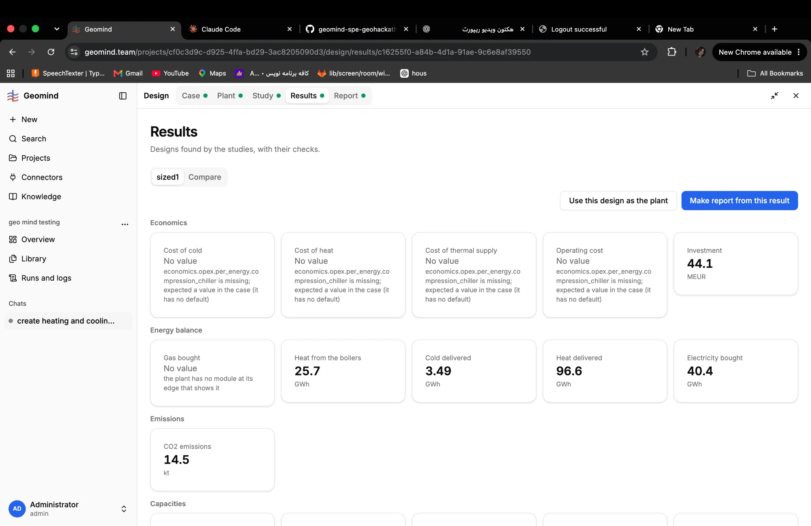
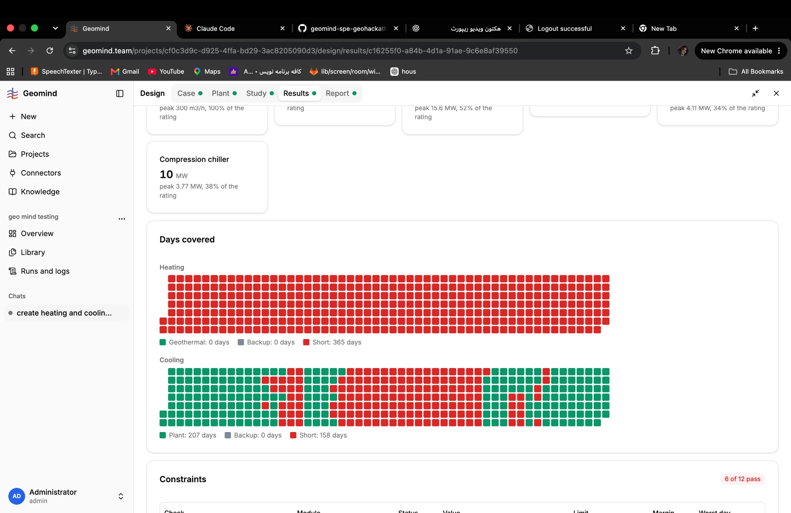
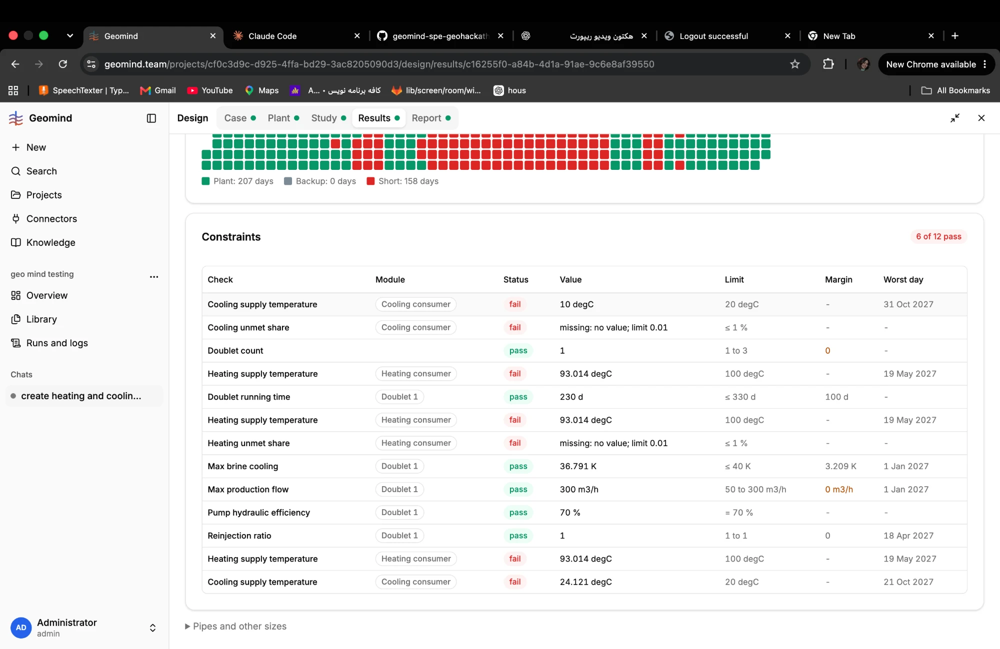

# QA-104: unmet_share requirements (heat/cold delivered, QA-091) are never evaluated: the check shows 'missing: no value' and fails the plant

| Field | Value |
|---|---|
| Status | fixed |
| Severity | major |
| Area | gemini,geomind |
| Reporter | Fatemeh (screenshots), Claude (DB read and write-up) |
| Found | 2026-11-05 10:41 UTC |
| Versions | backend 1.1.84 |
| Where | https://geomind.team/projects/cf0c3d9c-d925-4ffa-bd29-3ac8205090d3/design/results/c16255f0-a84b-4d1a-91ae-9c6e8af39550 (project geo mind testing, study sized1, chat 27379f2e) |
| Fixer | hotfix-python |

## Steps

1. A case with the new requirements of QA-091: `{"name": "heating_unmet_share", "on": "heating_supply", "quantity": "unmet_share", "max": 0.01}` and the same for cooling (case version 3).
2. The design team sizes and simulates the plant (study sized1) and checks it.

## Expected

The share of the demand that is not met is computed (Heat delivered 96.6 GWh and Cold delivered 3.49 GWh are on the same page) and compared with 1 %.

## Actual

Constraints: "Heating unmet share: fail, missing: no value; limit 0.01" and "Cooling unmet share: fail, missing: no value; limit 0.01". The rule that the organisers' 365-day demand coverage rests on (QA-091) can never pass, so no plant is ever feasible.

## Evidence

- 
- 
- 
- Postgres read-only: case_versions of project cf0c3d9c, number 3 (10 requirements).
- Comparison: on 2026-11-02 (project 'Live test d', run fc41f258) the same kind of rule (`heat_delivered` / `cold_delivered`, quantity unmet_share, max 0.01, no over/when) was evaluated and check_results returned feasible: true (lcoh 39.1, lcoc 46.0 EUR/MWh). So unmet_share worked then: a regression since, or it fails only on a sized-study result.

## Cause

Guess: gemini's check finds no `unmet_share` series for the plant's heating_supply / cooling_supply roles in this result (a sized study result, not a simulate result?), or the role names differ from gemini's sample. The sample (gemini/examples/hackathon_2026) evaluates heat_delivered / cold_delivered on its six plants, so compare that result's report with this one.

## Fix

- 2026-11-05 11:01 UTC: gemini 0.6.13 (unmet_share with failed steps: passed None, reason names them) + geomind 0.4.81, backend 1.1.86, deployed 11:00 UTC by hotfix-python-III
## Retest
