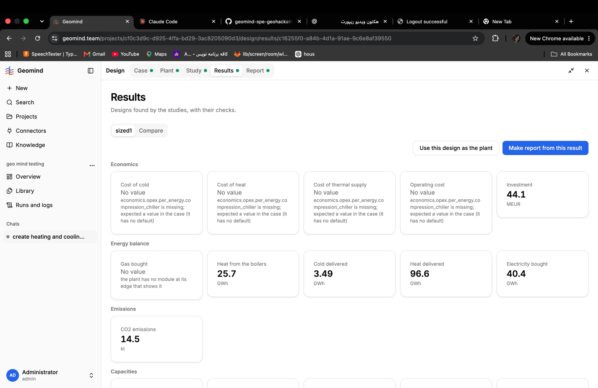
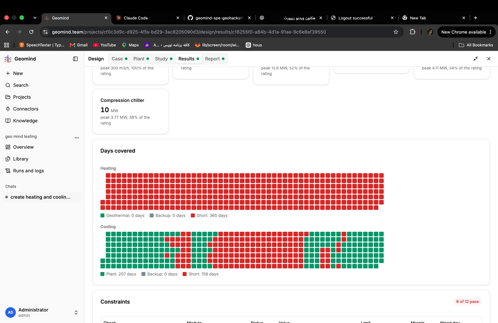
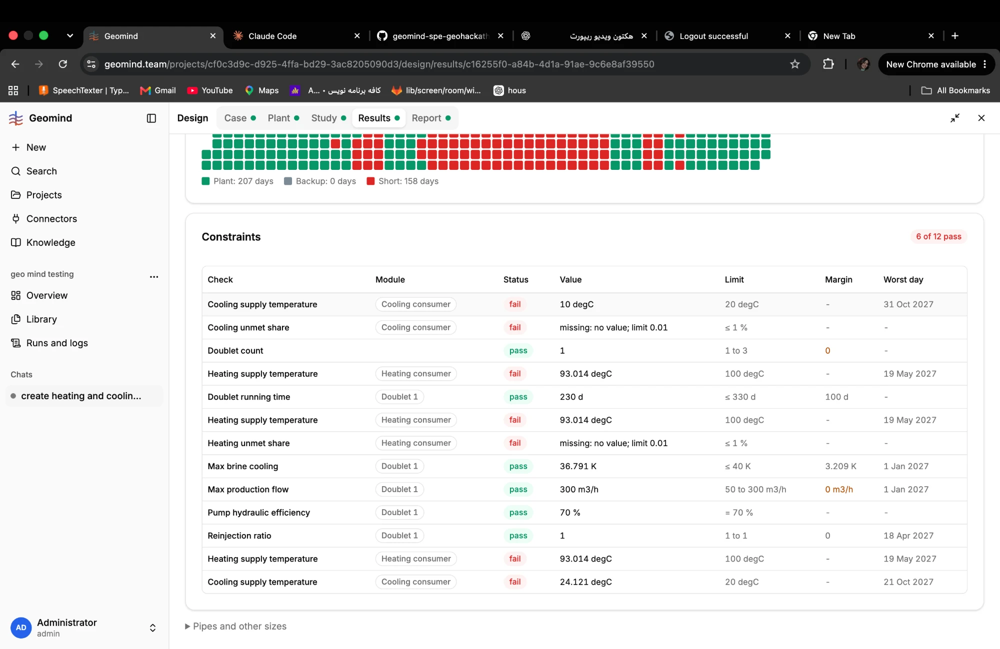
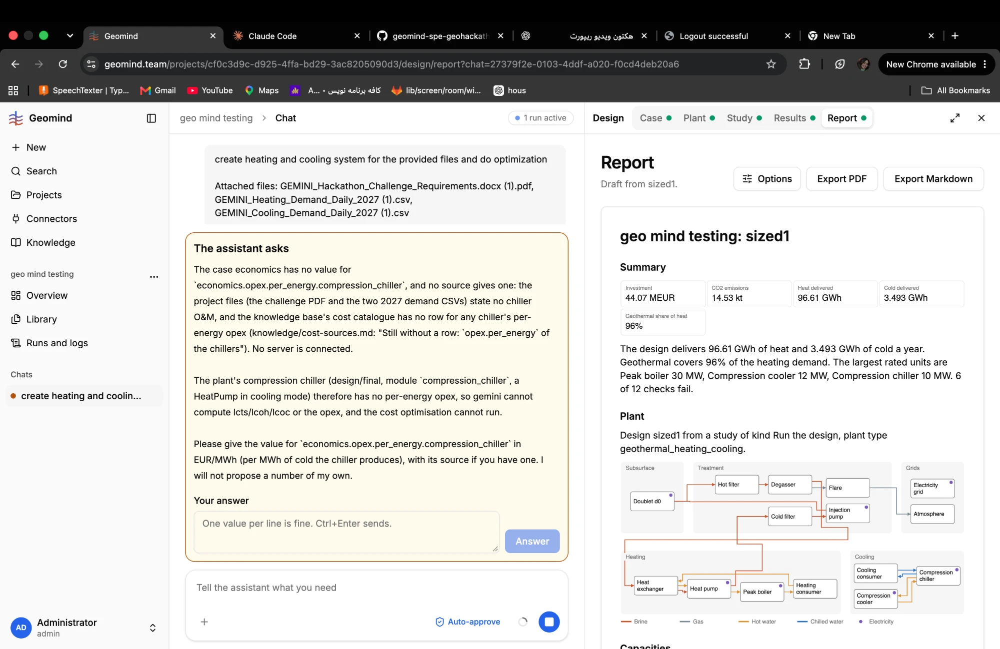

# QA-105: A plant with a compression chiller is sized while economics.opex.per_energy.compression_chiller is open: every cost metric is No value, so optimisation on cost cannot run

| Field | Value |
|---|---|
| Status | fixing |
| Severity | major |
| Area | geomind |
| Reporter | Fatemeh (screenshots), Claude (DB read and write-up) |
| Found | 2026-11-05 10:41 UTC |
| Versions | backend 1.1.84 |
| Where | https://geomind.team/projects/cf0c3d9c-d925-4ffa-bd29-3ac8205090d3/design/results/c16255f0-a84b-4d1a-91ae-9c6e8af39550 (project geo mind testing, study sized1, chat 27379f2e) |
| Fixer | hotfix-python |

## Steps

1. The case lead sets the economics (ask_economics "approve all, economics set, 6+ keys").
2. The design team picks a plant with a compression chiller, sizes and simulates it.

## Expected

Before sizing, the case holds every economics key the chosen plant needs (set_case's plants_need, QA-069), or the user is asked for the missing one; the cost metrics compute.

## Actual

Cost of cold, Cost of heat, Cost of thermal supply and Operating cost are all "No value: economics.opex.per_energy.compression_chiller is missing; expected a value in the case (it has no default)". Only Investment (44.1 MEUR) shows. With no lcts/lcoh, `optimize` on cost cannot run, so the "do optimization" the user asked for cannot happen. The catalogue has no per-energy row for chillers (known since QA-006); in another run the user had to give 1.69 EUR/MWh.

## Evidence

- 
- 
- 
- Postgres read-only: case_versions of project cf0c3d9c, number 3 (10 requirements).
- ~12:00 UTC the run asks the user for `economics.opex.per_energy.compression_chiller` (EUR/MWh cold) and says "I will not propose a number of my own". That is against Sahand's QA-010 decision (option A, 2026-11-04 21:40 UTC: for a value no source gives, propose an engineering assumption labelled 'no source' with a reason, and set it on approval). A usable proxy is in the catalogue: the compression chiller is a HeatPump in cooling mode, and `per-energy-heat-pump-dea-ch40-excess-heat-10mw-2025col` gives 1.69 EUR/MWh (DEA, verified); another run used exactly that value with the user's approval (A13, run 3bdd7ebb). 

## Cause

Fact: the case's economics has no opex.per_energy for the compression chiller. Guess: the case lead checks plants_need for the plant family it expects, not for the plant the design team builds later, and nobody checks the economics again before sizing. Fix: the design lead (or size_plant's precheck) asks for the economics keys of the chosen modules before sizing; and a catalogue row (or the organisers' guidance) for chiller O&M.

## Fix

## Retest
