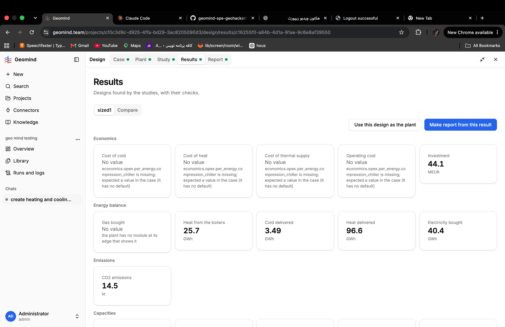
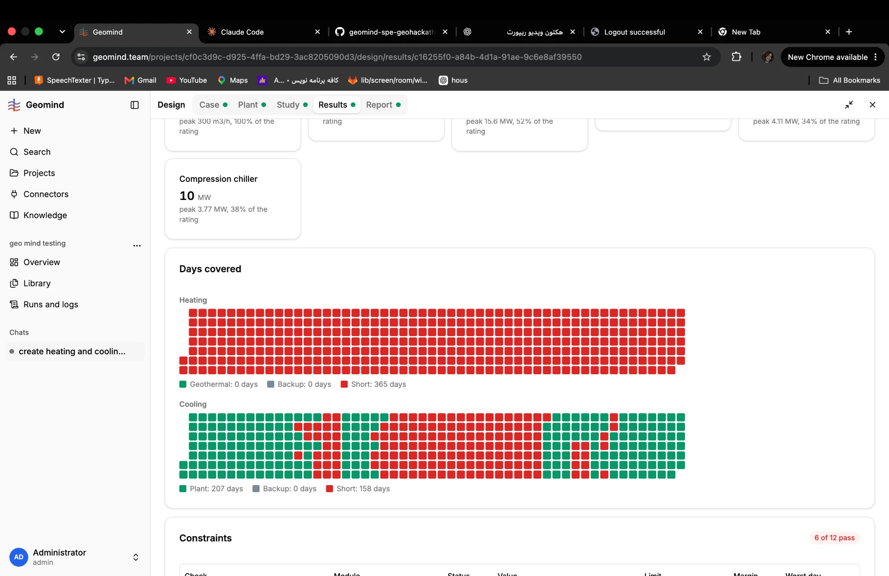
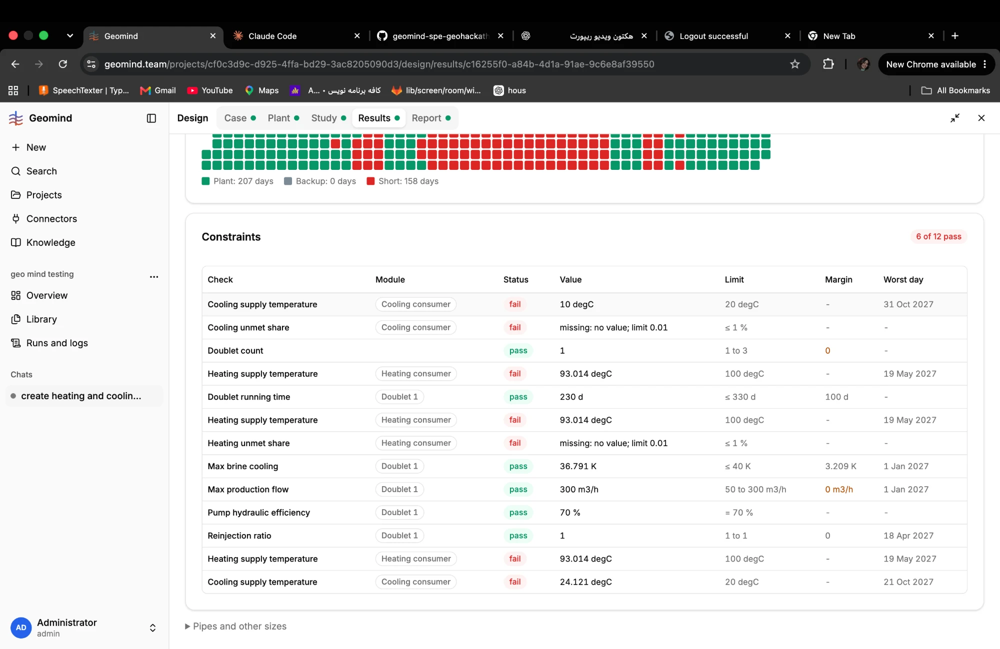

# QA-106: Results, Constraints: 12 rows for the case's 10 requirements; the supply temperature rules show two or three times with different values

| Field | Value |
|---|---|
| Status | open |
| Severity | minor |
| Area | frontend,backend |
| Reporter | Fatemeh (screenshots), Claude (DB read and write-up) |
| Found | 2026-11-05 10:41 UTC |
| Versions | backend 1.1.84 |
| Where | https://geomind.team/projects/cf0c3d9c-d925-4ffa-bd29-3ac8205090d3/design/results/c16255f0-a84b-4d1a-91ae-9c6e8af39550 (project geo mind testing, study sized1, chat 27379f2e) |
| Fixer | |

## Steps

1. Open the Results of study sized1; scroll to Constraints.

## Expected

One row per requirement of the case (10), each once.

## Actual

"6 of 12 pass": 12 rows for 10 requirements. Heating supply temperature shows three times (93.014 degC each, worst day 19 May 2027); Cooling supply temperature shows twice with different values (10 degC, worst day 31 Oct 2027; 24.121 degC, worst day 21 Oct 2027) and no word on what differs. The case has each rule once.

## Evidence

- 
- 
- 
- Postgres read-only: case_versions of project cf0c3d9c, number 3 (10 requirements).

## Cause

Guess: the check returns one row per module that serves the role (several pipes or consumers on the heating side?) or per failure group, and the page lists them without the module or the reason that tells them apart (all show "Heating consumer").

## Fix

## Retest
