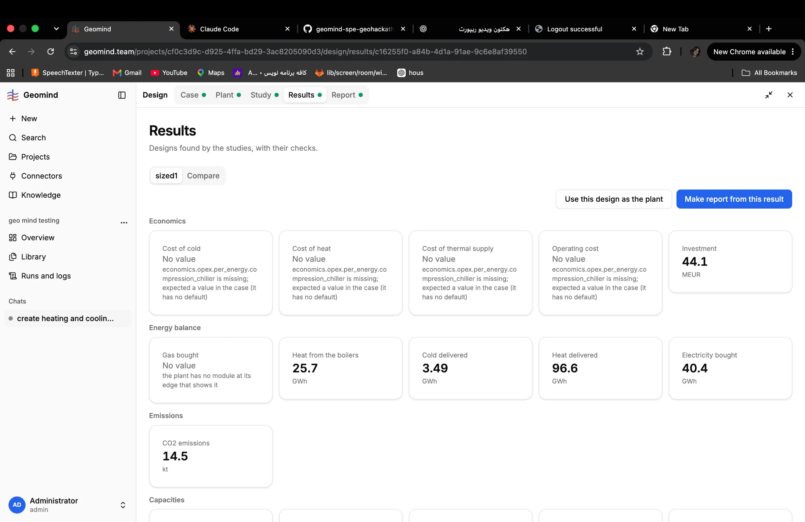
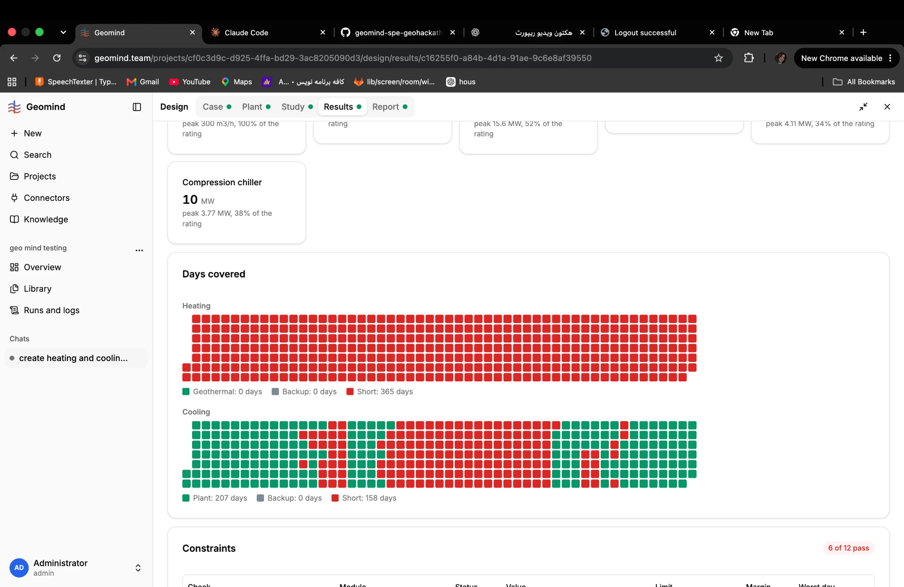
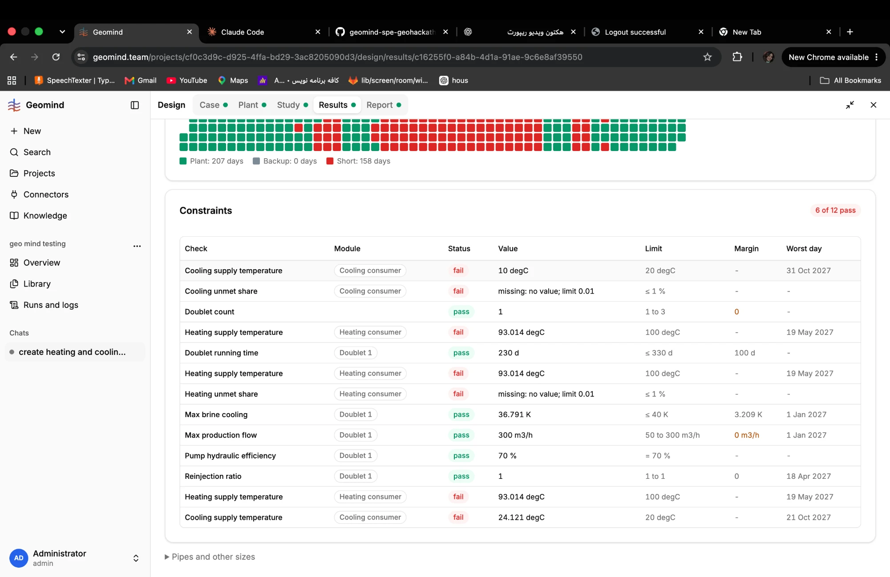

# QA-107: Results, Days covered: heating shows Geothermal 0 days and Short 365 days although the doublet ran 230 days

| Field | Value |
|---|---|
| Status | open |
| Severity | minor |
| Area | gemini,frontend |
| Reporter | Fatemeh (screenshots), Claude (DB read and write-up) |
| Found | 2026-11-05 10:41 UTC |
| Versions | backend 1.1.84 |
| Where | https://geomind.team/projects/cf0c3d9c-d925-4ffa-bd29-3ac8205090d3/design/results/c16255f0-a84b-4d1a-91ae-9c6e8af39550 (project geo mind testing, study sized1, chat 27379f2e) |
| Fixer | |

## Steps

1. Open the Results of study sized1; Days covered.

## Expected

The heating strip shows the days the geothermal doublet carried the heat (the doublet ran 230 d, Doublet running time on the same page) and the days the boilers or backup did.

## Actual

Heating: "Geothermal: 0 days, Backup: 0 days, Short: 365 days": every day red. Yet Heat delivered is 96.6 GWh of 111.7 GWh demand, heat from the boilers 25.7 GWh and the doublet ran 230 days. Either every day is a little short (then the strip should say how short) or the classes are wrong.

## Evidence

- 
- 
- 
- Postgres read-only: case_versions of project cf0c3d9c, number 3 (10 requirements).
- The report of the same result says "Geothermal share of heat 96%" in its Summary, while Days covered says Geothermal 0 days: the two contradict each other.

## Cause

Guess: a day counts as Short when the supply temperature misses 100 °C (93 °C every day here) or when any MWh is unmet, so the strip hides that geothermal did run. The legend needs the rule, or a "partly short" class.

## Fix

- 2026-11-05 10:47 UTC: for hotfix-python-III and hotfix-front: not backend (backend passes gemini daily_coverage as is); analysis in Fix
- 2026-11-05 10:53 UTC: hotfix-front-II takes part (b) (frontend: partly short days with the unmet share, legend states the rule); part (a) stays with its owner
## Retest
