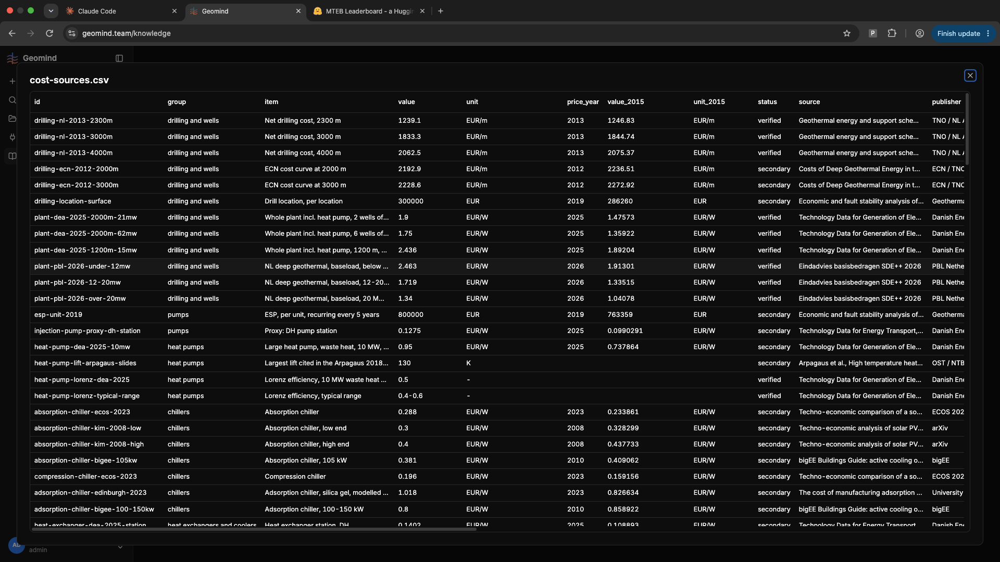
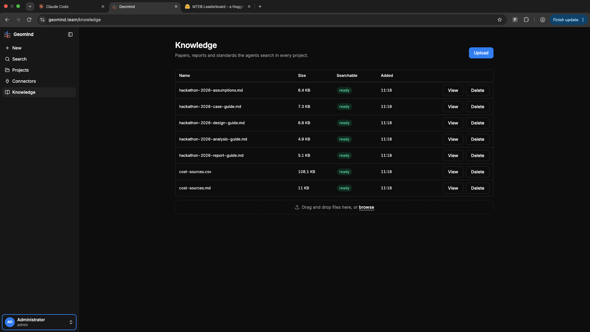

# QA-108: Shared data table: header and rows share one background; no zebra striping

| Field | Value |
|---|---|
| Status | fixing |
| Severity | minor |
| Area | frontend |
| Reporter | user via coordinator |
| Found | 2026-11-05 10:42 UTC |
| Versions | frontend 1.1.86 |
| Where | https://geomind.team/knowledge, View cost-sources.csv; every shared DataTable |
| Fixer | hotfix-front-II |

## Steps

1. Open Knowledge, View cost-sources.csv.
2. Look at the header and the rows.

## Expected

Three slightly different backgrounds: header row, even rows, odd rows (subtle zebra striping), in dark and light theme, from shadcn/Tailwind theme tokens; hover still visible; the sticky header keeps its own colour. Everywhere the DataTable is used.

## Actual

Header and all rows share one background.

## Evidence

- 
- 

## Cause

The DataTable (QA-096) gave the header `bg-background` and the rows no colour of their own.

## Fix

frontend 1.1.88 (hotfix-front-II), in `dataTableClass` of `src/shared/ui/data-table.tsx`: header `bg-sunken`, odd rows page colour, even rows `bg-sunken/60`, hovered row `bg-sunken` (rule raised above the stripe), selected and recommended rows keep theirs. Checked locally in light and dark on cost-sources.csv: header rgb(245,245,245) / rgb(38,38,38), even rows sunken at 0.6, hovered row clearly lighter. Deploy: 11:00 UTC window with QA-103.

Addition (user, 10:47 UTC: every table, a row-number column '#'): frontend 1.1.90, commit 22b5c0b: `.data-table-numbered` (CSS counter, `styles/index.css`) on by default in DataTable/DataTableFrame and Markdown tables, off for Alternatives and evolve structures (own rank); the chat's runs window moved to DataTableFrame, so no table in the app is left outside the shared one. Checked locally: CSV view and runs list show '#' 1..n, muted; even rows sunken at 0.6.
- 2026-11-05 10:48 UTC: user addition 10:47 UTC: every table gets the three colours and a row-number column '#' (on by default, a prop turns it off where a table has its own index), including the lists with actions
## Retest

(Who, when, result.)
