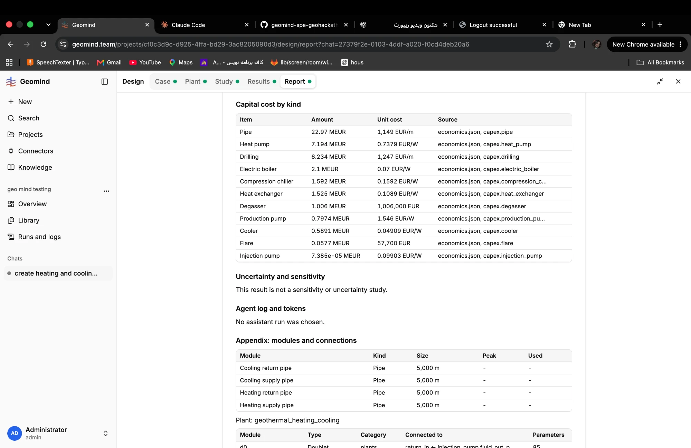
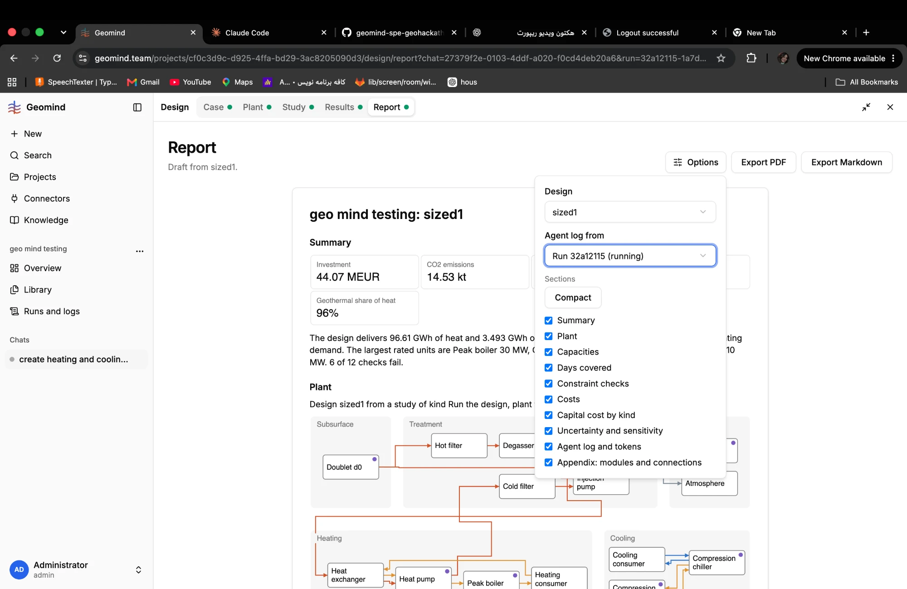

# QA-109: Report: the Agent log section is empty by default ('No assistant run was chosen'); the run that made the result is not picked

| Field | Value |
|---|---|
| Status | verified |
| Severity | minor |
| Area | frontend |
| Reporter | Fatemeh (screenshots), Claude (write-up) |
| Found | 2026-11-05 10:43 UTC |
| Versions | backend 1.1.84 |
| Where | https://geomind.team/projects/cf0c3d9c-d925-4ffa-bd29-3ac8205090d3/design/report?chat=27379f2e-0103-4ddf-a020-f0cd4deb20a6 (report of sized1) |
| Fixer | hotfix-front-III |

## Steps

1. Open Design > Report for the result sized1 (made by the assistant's run 32a12115).
2. Scroll to "Agent log and tokens".

## Expected

The section shows the run that made the result (the study's `started_by_run_id`), or the chat's latest run, without opening Options.

## Actual

"No assistant run was chosen." The user must open Options and pick "Run 32a12115 (running)" by hand; then the URL gets `&run=...`.

## Evidence

- 
- 

## Cause

Fact: `frontend/src/domains/design/report/report-editor.tsx` line 67, `const run = params.get("run") ?? ""`: no run unless the URL has one. Fix: default to the result's study `started_by_run_id` (or the chat's latest run when `chat=` is in the URL).

## Fix

hotfix-front-III, frontend 1.1.100 (c7a17a7), QA-127 and QA-109 together: `report/defaults.ts` picks the result: design results whose checks all pass (none failed, none not assessed), the best on the objective of the newest minimize/maximize study among them, else the newest feasible, else the newest result; the run is the result's study `started_by.run` (empty when a user started the study). A `result` or `run` in the URL still wins. Checked locally against production data: 'geo mind testing' opens lcts_best (12/12, lcts 70.95 vs lcts_fixed 72.94) with run 32a12115's log; QA3 study opens sized2 with its run. Deploy 14:30 UTC.
- 2026-11-05 14:27 UTC: frontend 1.1.104 deployed 14:27 UTC, bundle index-DjTPYa7Q.js
## Retest

- 2026-11-05 14:29 UTC: live 1.1.104: Agent log filled by default with the study's run (32a12115 for lcts_best); user-started study shows no run, as it has none
