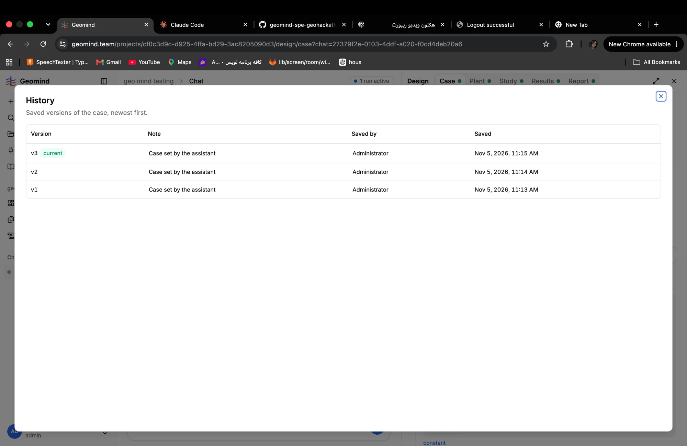

# QA-110: Case History: a version cannot be opened, compared or restored; the note is always 'Case set by the assistant' and Saved by says Administrator

| Field | Value |
|---|---|
| Status | fixing |
| Severity | major |
| Area | frontend,backend,geomind |
| Reporter | Fatemeh (screenshot), Claude (write-up) |
| Found | 2026-11-05 10:45 UTC |
| Versions | backend 1.1.84 |
| Where | https://geomind.team/projects/cf0c3d9c-d925-4ffa-bd29-3ac8205090d3/design/case?chat=27379f2e-0103-4ddf-a020-f0cd4deb20a6, Case > History |
| Fixer | hotfix-back-II |

## Steps

1. A run sets the case three times (v1 11:13, v2 11:14, v3 11:15).
2. Open Case > History.

## Expected

The user can see what each version holds and what changed: open a version, see the differences to the one before (paths, old and new values, with their source), and restore an older one, as the Plant History can (Restore). The note says what changed ("requirements: heating_unmet_share added"), and Saved by names the assistant when the assistant saved it.

## Actual

A read-only list: Version, Note, Saved by, Saved. No row opens; no compare; no restore. Every note is "Case set by the assistant". Saved by says "Administrator" for versions the assistant made. Since every value in the case must carry its source and the user approves it (the no-default rule), the user has no way to see which values changed and why.

## Evidence

- 
- `frontend/src/domains/design/case/history-panel.tsx`: the case panel takes no `onRestore` and has no row action; the plant's history panel has Restore.

## Cause

Fact (code): the case history renders a plain table. Guess: the backend stores each version's content (case_versions.content) but no change summary; the note comes from geomind's set_case with a fixed text, and the author is the logged-in user who owns the run. Fix: a row opens the version read-only with a diff to the previous one (paths and values, source), a Restore like the plant's, a note built from the changed paths, and Saved by "Assistant (run <id>)".

## Fix

## Retest
