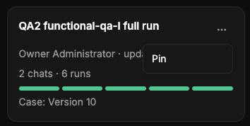

# QA-111: Projects page: a project card's ... menu has only Pin (no Settings, Rename, Delete)

| Field | Value |
|---|---|
| Status | verified |
| Severity | minor |
| Area | frontend |
| Reporter | user via coordinator |
| Found | 2026-11-05 10:45 UTC |
| Versions | frontend 1.1.86 |
| Where | https://geomind.team/projects, a project card's ... menu |
| Fixer | hotfix-front-II |

## Steps

1. Open Projects.
2. Open the ... menu of a project card.

## Expected

Pin, Settings (opens the project's settings), Rename, Delete (confirm dialog naming the project, destructive style): the same actions and components as the project menu in the sidebar.

## Actual

Only Pin.

## Evidence

- 

## Cause

The card had its own PinMenu; the sidebar's ProjectMenu (Pin, Rename, Settings) lived in `app/layouts`, which a feature may not import.

## Fix

frontend 1.1.89 (hotfix-front-II): `domains/workspace/settings/project-menu.tsx` holds the one menu (Pin, Rename, Settings, Delete with a confirmation naming the project); the sidebar and the cards use it; `workspace/routes.ts` passes it to the Projects page. No backend change (PATCH and DELETE /workspace/projects/{id} exist). Checked locally on a card: the four items; Delete opens 'Delete <name>?' and Keep it closes it; Rename shows the name; Settings opens the settings window; no DELETE/PATCH sent. Deploy: 11:00 UTC window.
- 2026-11-05 11:02 UTC: deployed 11:01 UTC, live 1.1.92 bundle index-BnoB2Kcd.js; live verification left to hotfix-front-III (handover at the context limit)
## Retest

(Who, when, result.)
- 2026-11-05 11:04 UTC: live 1.1.92: project card menu Pin, Rename, Settings, Delete; dialogs open, nothing written
