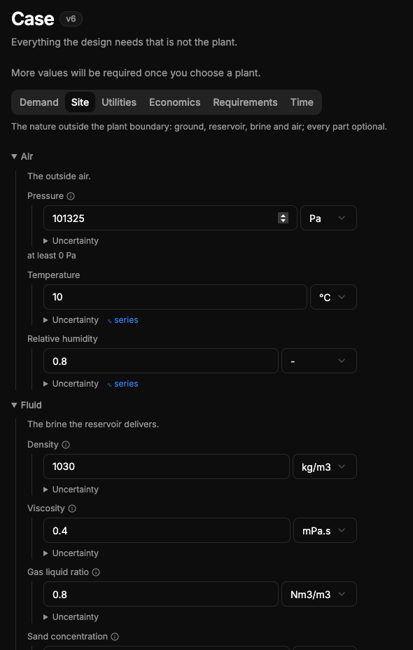

# QA-115: Schema forms (Case, Plant, Economics ...): every collapsible group opens by default

| Field | Value |
|---|---|
| Status | fixing |
| Severity | minor |
| Area | frontend |
| Reporter | user via coordinator |
| Found | 2026-11-05 11:00 UTC |
| Versions | frontend 1.1.86 |
| Where | Design > Case form (and Plant, Economics: every schema form, `src/shared/forms`) |
| Fixer | hotfix-front-III |

## Steps

1. Open Design > Case.
2. Look at the groups (Air, Fluid, Ground, Reservoir ...).

## Expected

Every group collapsed by default; the user opens what they want. A group holding a validation error or a missing required value opens (or shows a marker) so problems are not hidden. The open/closed state stays while the user stays on the page.

## Actual

The groups open by default.

## Evidence

- 

## Cause

(Facts, or a guess marked as one.)

## Fix

(Hotfix session: cause, commit, version, deployed at.)

## Retest

(Who, when, result.)
