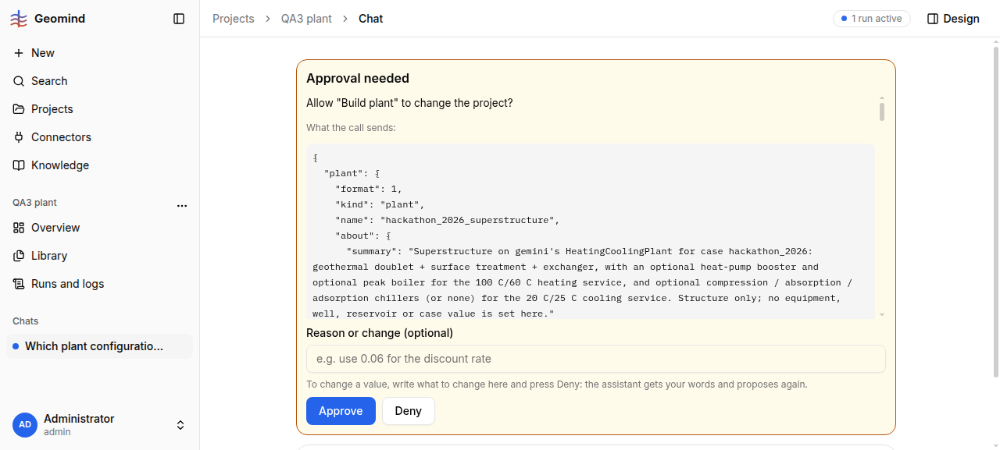

# QA-116: Agent proposes Build plant three times after two explicit denials of an explanation-only request

| Field | Value |
|---|---|
| Status | fixing |
| Severity | major |
| Area | geomind |
| Reporter | functional-qa-plant-I |
| Found | 2026-11-05 11:01 UTC |
| Versions | backend 1.1.86 (health at 11:01 UTC; run started on 1.1.84) |
| Where | https://geomind.team/projects/c45a5382-af55-43fc-9340-dd1ab1245533/assistant/chat/6732957b-7035-481a-bc31-7f4abcda2a76; project QA3 plant (case set); scenario plant-I-S1 |
| Fixer | hotfix-python |

## Steps

1. In the QA3 plant chat send: "Which plant configurations can cover this case's heating and cooling demand? Please explain the options briefly and say what the 87 C reservoir temperature means for the 100 C heating supply." (an explanation request only).
2. The agent works 32 steps, then asks approval for "Build plant" (hackathon_2026_superstructure). Deny with reason: "I only asked for an explanation ... answer in text".
3. The agent asks "Build plant" again (superstructure, 1 doublet). Deny: "No plant build now. Do not call any tool that changes the project. Reply with text only."
4. After 66 steps the agent asks "Build plant" a third time.

## Expected

An explanation request is answered in text; after a denial with a reason the agent obeys it and answers, without asking to change the project again.

## Actual

The agent asked for a plant build three times, ignored both denial reasons, and gave no text answer in 66+ steps (the user never gets the explanation without approving a change they refused). Also the proposed plant fixes 1 doublet although 1-3 are allowed (to check later).

## Evidence

- 
- Run JSON: `../evidence/QA-116/run-<id>.json`

## Cause

(Facts, or a guess marked as one.)

## Fix

hotfix-python-III, 2026-11-05, geomind 0.4.82/0.4.83, backend 1.1.88 (deploy 11:30 UTC).
Fix: a tool the user denied is not asked again in the same request by any agent of the run tree
(`engine/session.py::earlier_denial`): the call is denied with the user's reason and "answer in
text with what you have". The project lead's prompt: an explanation request is answered in text
and builds, patches and simulates nothing.

## Retest

(Who, when, result.)
