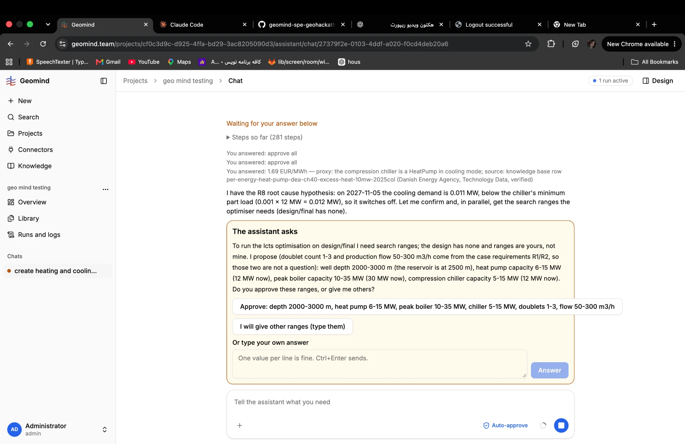

# QA-117: Question card: a long option button runs past the card's right edge (no wrap)

| Field | Value |
|---|---|
| Status | fixing |
| Severity | cosmetic |
| Area | frontend |
| Reporter | Fatemeh (screenshot), Claude (write-up) |
| Found | 2026-11-05 11:05 UTC |
| Versions | frontend as deployed 2026-11-05 ~12:30 UTC |
| Where | https://geomind.team/projects/cf0c3d9c-d925-4ffa-bd29-3ac8205090d3/assistant/chat/27379f2e-0103-4ddf-a020-f0cd4deb20a6, question card 'The assistant asks' |
| Fixer | hotfix-front-III |

## Steps

1. The agent asks a question with a long option ("Approve: depth 2000-3000 m, heat pump 6-15 MW, peak boiler 10-35 MW, chiller 5-15 MW, doublets 1-3, flow 50-300 m3/h").

## Expected

The option's text wraps inside the card.

## Actual

The option button is one line wider than the card and runs past its right edge.

## Evidence

- 

## Cause

Fact: `frontend/src/components/ui/button.tsx` has `whitespace-nowrap shrink-0` in the base style; `src/domains/assistant/chat/request-card.tsx` line 83 uses that Button for each option inside `flex flex-wrap`. Fix: on the option buttons, `whitespace-normal h-auto text-left max-w-full` (or a list of full-width options).

## Fix

hotfix-front-III, frontend 1.1.94 (44464f2): option buttons get `h-auto max-w-full py-1.5 text-left whitespace-normal`. Deploy 11:30 UTC.

## Retest
