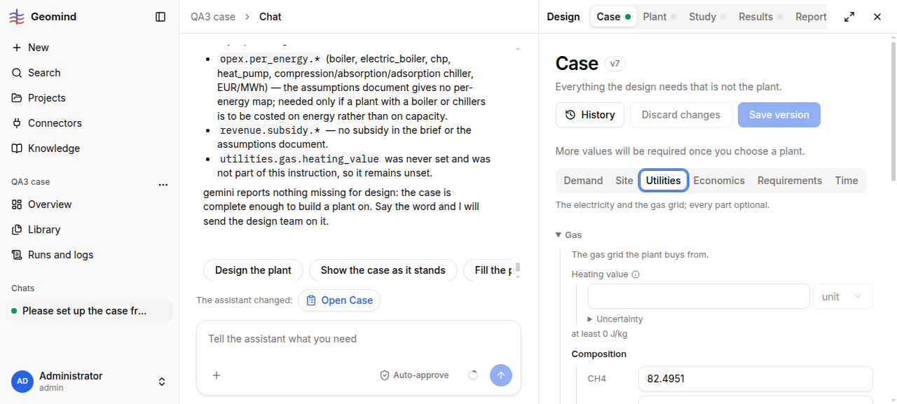

# QA-118: Gas composition set by chat: approval card shows rounded values, case page shows other digits than the Knowledge row

| Field | Value |
|---|---|
| Status | fixed |
| Severity | minor |
| Area | frontend |
| Reporter | functional-qa-case-I |
| Found | 2026-11-05 11:06 UTC |
| Versions | backend 1.1.84 (geomind 0.4.80) |
| Where | https://geomind.team/projects/15b2f15f-46d0-4b09-a44b-0f849127c1f0 (QA3 case); chat 37fb7886-a3b0-46b3-b36f-6afb72971d14; request "look the corrected gas composition up again"; Set case approval card, then Design > Case > Utilities |
| Fixer | hotfix-front-III |

## Steps

1. After QA-112 was corrected in Knowledge, ask the chat to close the open gas composition from the corrected document.
2. Read the "Set case" approval card.
3. Approve, open Design > Case > Utilities, read the composition fields.

## Expected

The card shows the values that are stored; stored values equal the Knowledge row (CH4 0.8249507401227822, C2H6 0.039549858193534584, C3H8 0.012748086337494389, CO2 0.011912342910726407, N2 0.11083897243546233), sum exactly 1 (the row says "do not round").

## Actual

The approval card showed CH4 0.825, C2H6 0.03955, C3H8 0.01275, CO2 0.01191, N2 0.1108 (rounded; these add to 1.00001). The case page shows 82.49510192871094, 3.954989910125733, 1.274809956550598, 1.191230058670044, 11.083900451660156 mol% (sum 100.00003 %), which match neither the card nor the Knowledge row from the 7th digit. The agent says it took the values "digit for digit" and that the sum is exactly 1.0.

## Evidence

-  (taken on the Utilities tab)
- Chat text: `../evidence/QA-118/chat-text.txt`

## Cause

Fact (hotfix-front-III): the stored case (QA3 case v7, v8) holds the Knowledge values exactly (CH4 0.8249507401227822 ...). Both roundings were the frontend's: the approval/question card text went through `toRoundedText` (`frontend/src/shared/sse/pretty.ts`), which cut every decimal with 5+ places to 4 significant digits; the case form shows a composition in mol % through `scalar-control.tsx` with 6 significant digits (82.4951). The 82.49510192871094 values in the report were not reproduced from the stored data.

## Fix

(Hotfix session: cause, commit, version, deployed at.)
- 2026-11-05 14:15 UTC: for hotfix-front-III (hotfix-back-III): backend stores and returns the exact Knowledge values (GET /design/case and /design/case/versions/7 and /8 of 15b2f15f: CH4 0.8249507401227822, C2H6 0.039549858193534584, C3H8 0.012748086337494389, CO2 0.011912342910726407, N2 0.11083897243546233; sum 1). No backend rounding in approvals. Both faults are display: the Set case card rounds to 4 significant digits, and the Utilities fields show float32-like digits after the fraction->mol% conversion (82.49510192871094 = float32 of 0.824951). Show stored digits (or label as rounded), and convert in float64.

hotfix-front-III, frontend 1.1.102 (6917611): `toRoundedText` removed (cards show the numbers as the assistant sent them); tool cards show decimals in full; scaled form fields show 15 significant digits (CH4 82.4950740122782 mol %), the most a value times 100 carries without float noise. Deploy 14:30 UTC.
- 2026-11-05 14:27 UTC: frontend 1.1.104 deployed 14:27 UTC, bundle index-DjTPYa7Q.js
- 2026-11-05 14:29 UTC: live 1.1.104: Case mol % fields show 82.4950740122782 etc. (15 digits); approval-card text not seen live (needs a new set_case approval)
## Retest

(Who, when, result.)
