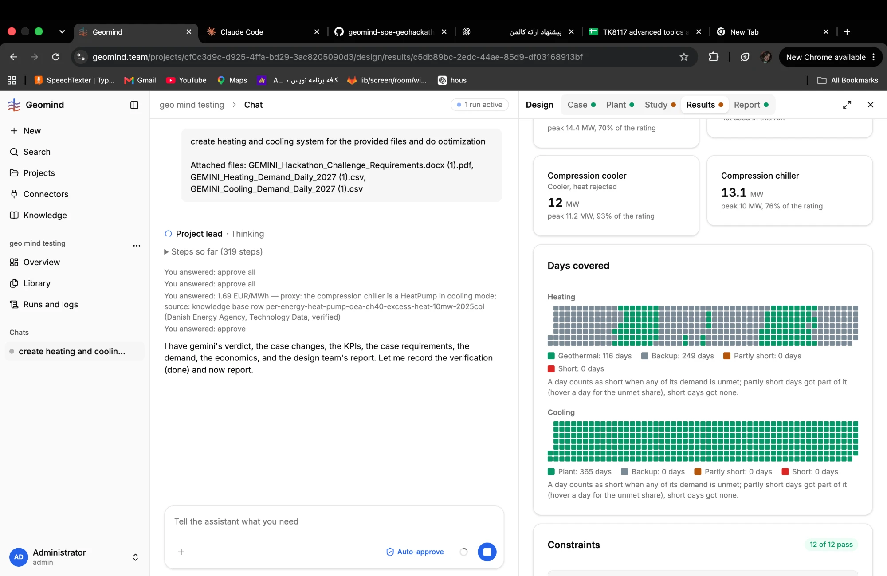

# QA-126: Days covered: one grey 'Backup' class for any boiler heat; a day 99 % geothermal looks like a day the boiler did alone; the share of heat is not shown

| Field | Value |
|---|---|
| Status | open |
| Severity | major |
| Area | frontend |
| Reporter | Fatemeh (question and screenshot), Claude (data and write-up) |
| Found | 2026-11-05 11:22 UTC |
| Versions | backend 1.1.86 / gemini as deployed 2026-11-05 ~12:45 UTC |
| Where | https://geomind.team/projects/cf0c3d9c-d925-4ffa-bd29-3ac8205090d3/design/results/c5db89bc-2edc-44ae-85d9-df03168913bf (result lcts_best, 12 of 12 pass), Days covered |
| Fixer | |

## Steps

1. Open the Results of lcts_best; Days covered, Heating.

## Expected

The user sees how much of the heat geothermal gave and how much the backup (boilers) gave, and tells apart a day the doublet was off (the boiler alone) from a day the boiler only topped up the peak.

## Actual

"Geothermal: 116 days, Backup: 249 days". Fatemeh read it as "the boiler did most of the work" and asked what backup even is. The facts of this result (from its `coverage`, Postgres read-only):
- the boiler (electric) gave 21.5 % of the year's heat (23,975 of 111,668 MWh); geothermal 78.5 %;
- on the 249 backup days the boiler's median share is 25 %; on 31 of them under 5 %; on 35 it gave everything (the doublet's outage days);
- by month: January 39 %, December 34 %, February 29 % (peak top-up; heat pump 11.4 MW, one doublet; on the peak day the boiler gives 14.4 of 30 MW); April and October 0 %; May 57 % (21 outage days, `control.outages = lowest_demand`); July 14 %, August 31 % with the doublet on and demand at 3-4 MW (unexplained, see Cause).

## Evidence

- 
- `gemini/gemini/evaluate/coverage.py` `_source`: a day is "backup" when its backup energy is above 1e-6 of its demand; "geothermal" only when it is 100 % geothermal. BACKUP_ROLES: boiler, chp, and ElectricBoiler by class.
- The PDF report already draws the daily heat as stacked areas by source (`backend/src/api/v1/reporting/design/figures.py`); the web page does not.

## Cause

Fact: one colour for any boiler heat, however small; two different events (doublet off, boiler topping up) share it; no energy share anywhere on the card. Proposal:
1. show the daily heat as stacked bars or areas (geothermal below, backup above, a demand line), as the PDF does;
2. or three classes: geothermal only / geothermal and boiler / boiler only (doublet off), plus partly short and short;
3. a line under the chart: "Boiler: 21.5 % of the year's heat; doublet off 35 days";
4. a tooltip "Backup = the boilers (gas, CHP, electric) that cover what geothermal cannot".
Separate question for the design team (not this bug): why the boiler runs in July and August with the doublet on.

## Fix

- 2026-11-05 14:14 UTC: for hotfix-front-III (hotfix-back-III): no backend change needed. GET result detail already gives coverage.heating/cooling[] per day with demand, geothermal, backup, short (MWh Figures) besides source; stacked bars, the three classes (geothermal only / both / backup only = geothermal 0), the year's backup share and doublet-off day count can all be computed from those. gemini's source classes unchanged.
## Retest
