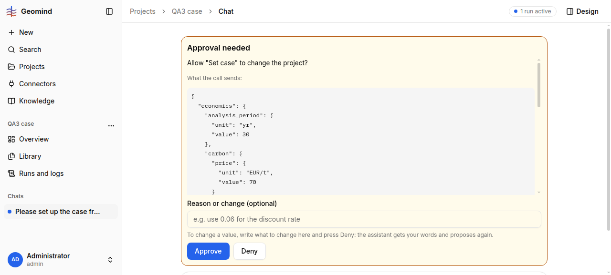

# QA-133: Cancel run does nothing on a run waiting at an approval card (stays 'waiting', 1 run active)

| Field | Value |
|---|---|
| Status | verified |
| Severity | major |
| Area | frontend |
| Reporter | functional-qa-case-I |
| Found | 2026-11-05 14:20 UTC |
| Versions | backend 1.1.88 |
| Where | https://geomind.team/projects/15b2f15f-46d0-4b09-a44b-0f849127c1f0 (QA3 case); chat 37fb7886-a3b0-46b3-b36f-6afb72971d14; run 11597465 (Runs and logs) |
| Fixer | hotfix-front-III |

## Steps

1. Start a case request in the chat; leave the run at a "Set case" approval card (waits for your approval).
2. Press "Cancel run" (clicked 4 times, by ref, by role and by DOM click, also after a reload).
3. Look at the chat list, the header and Runs and logs.

## Expected

The run is cancelled: status cancelled, "1 run active" gone, the chat accepts a new message.

## Actual

No toast, no change. The chat still says "waits for your approval", the header still says "1 run active", Runs and logs lists run 11597465 as waiting. Runs and logs has no cancel action. The run has lived across deploys (1.1.84 to 1.1.88).

## Evidence

- 

## Cause

Guess: cancel is not handled for the waiting status, or a deploy resume left the run without a process (see QA-077).

## Fix

(Hotfix session: cause, commit, version, deployed at.)
- 2026-11-05 14:29 UTC: hotfix-back-III, cause (fact, traefik access log 09:30-14:30 UTC): no POST /api/v1/assistant/runs/11597465-.../cancel ever reached the server; the only cancel near 14:20 was 14:21:04 for run 1461ca81 (QA3 study project, another session), 200, ended cancelled. So the chat's Cancel run button sends nothing while a run waits at an approval card (no toast either). Backend cancel_run handles waiting runs (resumes once with a stand-in answer, ends cancelled). Frontend fix for hotfix-front-III: send POST /runs/{id}/cancel for the waiting run (the run of the open approval card) and show the result; consider a cancel action in Runs and logs. Run 11597465 is still waiting; the cancel by API was refused to me, command given to the coordinator.

hotfix-front-III, frontend 1.1.105 (ff351c7), deployed 14:35 UTC (bundle index-CJFPBgLt.js). Cause (fact, reproduced at 1280x577 on QA qa-2 run 592f3730 with the cancel request intercepted): the request card in `chat/workspace.tsx` had no height limit, so a tall card filled the chat column and pushed the composer, with its Cancel run button, below the window where it could not be clicked (elementFromPoint at the button: nothing); at 1280x700 the same click sends POST /assistant/runs/{id}/cancel. Fix: the card is at most 45svh high and scrolls inside; Cancel run stays visible and sends the POST (checked intercepted on two waiting runs; no real run cancelled).
- 2026-11-05 14:35 UTC: frontend 1.1.105 deployed 14:35 UTC, bundle index-CJFPBgLt.js: card bounded, Cancel run reachable
## Retest

(Who, when, result.)
- 2026-11-05 14:36 UTC: live 1.1.105 at 1280x577: composer visible under the approval card, Cancel run hit-testable, click sends POST /assistant/runs/592f3730.../cancel (intercepted in the test, run not cancelled)
