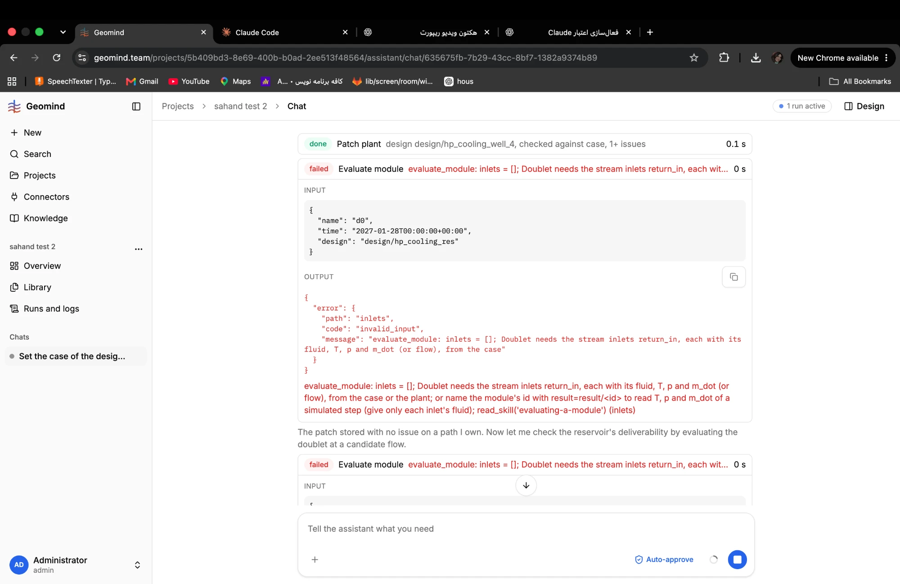
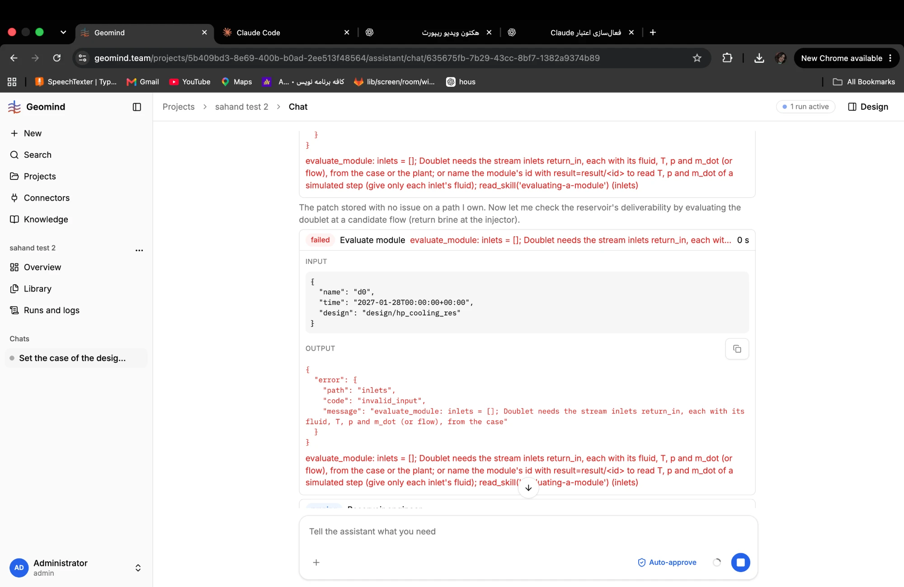

# QA-143: Reservoir engineer cannot evaluate the doublet of a stored design: evaluate_module 6 of 6 refused, the same call 3 times (inlets [] with design only)

| Field | Value |
|---|---|
| Status | fixed |
| Severity | major |
| Area | geomind |
| Reporter | Fatemeh (screenshots), Claude (run log and write-up) |
| Found | 2026-11-05 14:59 UTC |
| Versions | frontend 1.1.109, backend 1.1.95 (geomind 0.4.91) |
| Where | https://geomind.team/projects/5b409bd3-8e69-400b-b0ad-2ee513f48564/assistant/chat/635675fb-7b29-43cc-8bf7-1382a9374b89; project "sahand test 2"; run ed03d7ea-b97e-4f4e-9b47-5fba9ac51a70 (running, started 14:40:41 UTC) |
| Fixer | |

## Steps

1. In "sahand test 2", a design run (design lead with reservoir, well, process and energy engineers) on design `design/hp_cooling_res`.
2. The reservoir engineer checks the reservoir's deliverability by evaluating the doublet at a candidate flow.

## Expected

The engineer can evaluate `d0` of a stored design: either evaluate_module takes the inlets it needs from the design (IMP-013 says "evaluate_module takes its inlets from the design"), or the first refusal tells it the one working form and it uses it. No identical failing call a third time (IMP-015: after two identical errors change the call or hand back).

## Actual

Run log (88 steps so far, 153 tool calls, 14 errors): evaluate_module 6 calls, all 6 refused, all by the reservoir engineer:

1. `name: ProductionReservoir` with parameters by hand: invalid_design, `productivity_index is required`;
2. `name: d0.reservoir, design: design/hp_cooling_res`: unknown_name;
3. to 5. the same call three times, `{"name": "d0", "time": "2027-01-28T00:00:00+00:00", "design": "design/hp_cooling_res"}`: invalid_input, "inlets = []; Doublet needs the stream inlets return_in, each with its fluid, T, p and m_dot (or flow), from the case or the plant; or name the module's id with result=result/<id> ...";
6. `name: Doublet` with inlets by hand (return_in 47 degC, power_in): missing_value `reservoir.pressure`, the design's values are not used when the class name is given.

The chat shows the red failed cards one after the other (screenshots).

## Evidence

- 
- 
- Run log: GET /api/v1/assistant/runs/ed03d7ea-b97e-4f4e-9b47-5fba9ac51a70/log (read 2026-11-05 ~15:30 UTC).

## Cause

Fact (geomind 0.4.91, `geomind/tools/gemini/module_call.py` `prepared_call`): with `design` only, parameters and controls come from the design, but inlets come only from a stored result (`result_inlets` runs only when `results` is given). A doublet's `return_in` (injected brine) has no value in a design without a simulation, so `design=` alone can never pass `checked_inlets` for d0. The message offers "from the case or the plant", which the plant cannot give for return_in. Fact: the identical call was sent 3 times, so the IMP-015 rule did not stop it. Guess: the working path for a deliverability check is a short simulate, then `evaluate_module(name='d0', result=...)`, or inlets given by hand with `design=` kept so the reservoir values come from the design; the skill does not say so.

## Fix

(Hotfix session: cause, commit, version, deployed at.)
- 2026-11-05 15:14 UTC: geomind 0.4.93 (evaluate_module: class name with design resolves the module; inlet refusal explains design vs result; identical failed call not run again, failed_before), backend 1.1.97, deployed ~15:20 UTC
## Retest

(Who, when, result.)
