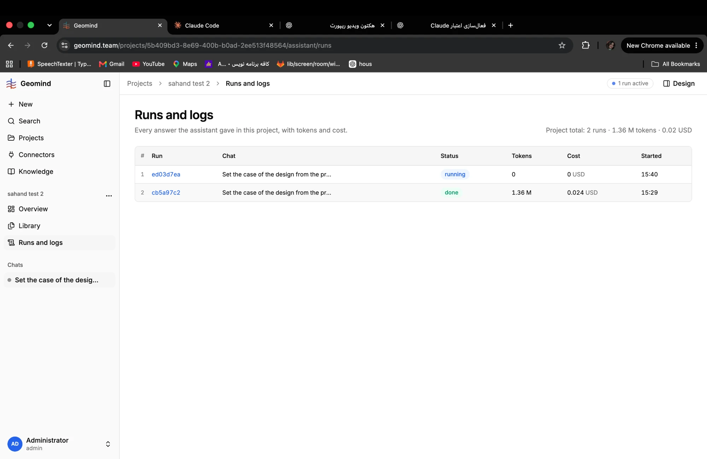

# QA-144: Runs and logs: a running run shows 0 tokens and 0 USD for an hour (run.usage stays 0) while its agents have 5.0 M input tokens and 0.15 USD

| Field | Value |
|---|---|
| Status | fixed |
| Severity | minor |
| Area | backend,frontend |
| Reporter | Fatemeh (screenshot), Claude (API read and write-up) |
| Found | 2026-11-05 15:12 UTC |
| Versions | frontend 1.1.111, backend 1.1.95 (geomind 0.4.91) |
| Where | https://geomind.team/projects/5b409bd3-8e69-400b-b0ad-2ee513f48564/assistant/runs; project "sahand test 2"; run ed03d7ea-b97e-4f4e-9b47-5fba9ac51a70 (running since 14:40:41 UTC) |
| Fixer | hotfix-back-IV |

## Steps

1. Open Runs and logs of "sahand test 2" while run ed03d7ea runs (started 14:40 UTC, about an hour of nested design agents).

## Expected

Tokens and Cost of a running run grow while it works (QA-046, backend 1.1.44: the run row adds the totals of running nested runs).

## Actual

The row shows Tokens 0 and Cost 0 USD (screenshot). GET /api/v1/assistant/runs/ed03d7ea... (~15:45 UTC) returns `usage: {input_tokens: 0, output_tokens: 0, cost: 0.0}`, `sessions: null`, `total: null`, while GET .../ed03d7ea.../agents returns totals `input_tokens 5,024,775, output_tokens 223,157, cached 2,730,496, cost 0.1507 USD, 131 steps, 127 LLM calls, 202 tool calls` over 15 agent sessions. The finished run above it (cb5a97c2) shows 1.36 M and 0.024 USD, so only running runs are wrong.

Also seen in the same agents list (not this bug's subject): three design_lead sessions and one "Reservoir engineer I" with status `failed`; a deploy (503 "GeoMind is updating") came at about 15:45 UTC.

## Evidence

- 
- API reads above (run row vs agents totals).

## Cause

(Guess.) The run row's usage is written only at the end, or the QA-046 sum of running nested runs no longer reaches `usage` since the agents/sessions totals moved to /agents (IMP-025 instances). The runs list reads `usage`.

## Fix

Cause: `UsageTree` (runs/adapters/callbacks.py) wrote live totals only for direct children of the root and only after the root's own first `usage`; with IMP-025 the work runs in grandchildren and the root's first step stays open. Fix: tree keyed by run_id with parents, any depth, root base 0 allowed; run total = max(own, sum of children). Backend 1.1.98, deployed (hotfix-back-IV, tag v1.1.98). Offline test tests/api/v1/assistant/runs/test_usage_tree.py. Frontend part: none needed (it reads run.usage).
- 2026-11-05 15:17 UTC: backend 1.1.98: live totals count nested runs at any depth; not live-checked
## Retest

Not live-checked (QA-test stop). Retest: start a design run with parallel instances; Runs and logs row Tokens/Cost must grow while it runs and match /runs/{id}/agents roughly.
