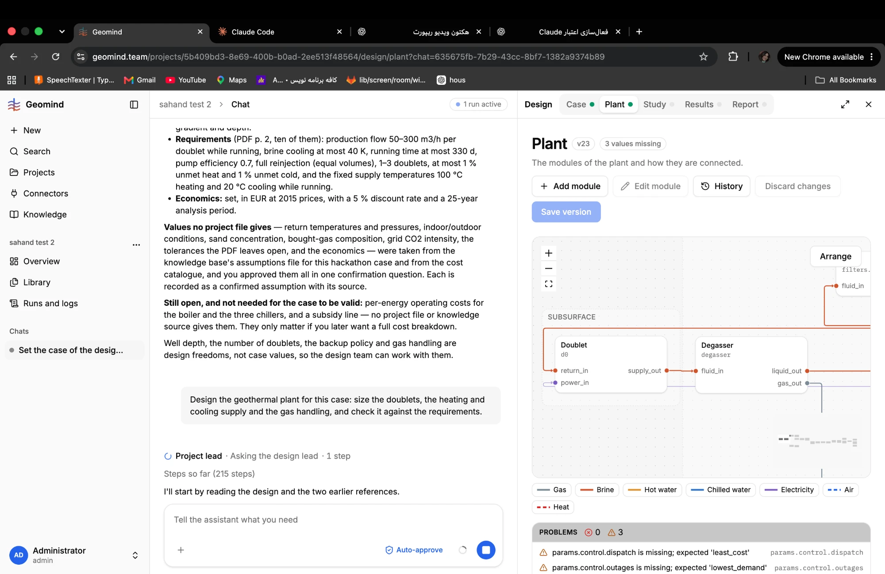

# QA-145: Design run 70 min, 23 plant versions and no simulate: 27 patch_plant by hand (3 empty), 107 of 231 calls are re-reads, work redone after design_lead failed 3 times

| Field | Value |
|---|---|
| Status | fixing |
| Severity | major |
| Area | geomind,backend |
| Reporter | Fatemeh (screenshot), Claude (run log and write-up) |
| Found | 2026-11-05 15:14 UTC |
| Versions | frontend 1.1.111, backend 1.1.95/1.1.96 (geomind 0.4.91) |
| Where | https://geomind.team/projects/5b409bd3-8e69-400b-b0ad-2ee513f48564/design/plant?chat=635675fb-7b29-43cc-8bf7-1382a9374b89; project "sahand test 2"; run ed03d7ea-b97e-4f4e-9b47-5fba9ac51a70 (running since 14:40:41 UTC) |
| Fixer | hotfix-python |

## Steps

1. "sahand test 2": the case is set (run cb5a97c2, done).
2. Ask: "Design the geothermal plant for this case: size the doublets, the heating and cooling supply and the gas handling, and check it against the requirements."

## Expected

A design that reaches simulate, check and (once all pass) optimize in reasonable time; a plant version saved per meaningful change, not per hand edit.

## Actual

At ~15:50 UTC (70 min, UI 215 steps; log read: 144 steps, 231 tool calls, 15 errors):
- Plant page: v23, "3 values missing" (params.control.dispatch 'least_cost', params.control.outages 'lowest_demand', ...), Study and Results empty.
- simulate 0, check 0, optimize 0, size 0, no study at all.
- patch_plant 27 (each saves a plant version), build_plant 2, merge_designs 1. Three patches send `changes: {}` or only `choices.note: null`.
- Values are filled module by module by hand (well, reservoir, energy, setpoints, frequencies); the energy engineer sends the same series twice (hp_cooling_energy_6..9, then energy_11..14 with the same changes) after a design_lead restart.
- Re-reads: read_case 38, read_plant 35, read_stored 34 = 107 of 231 calls (46 %).
- Agents list: 3 design_lead sessions and "Reservoir engineer I" `failed`; a deploy (503 "updating") at ~15:45 UTC. Work after each failure starts over.
- evaluate_module 6 of 6 refused (QA-143).

## Evidence

- 
- Run log (API /log at ~15:50 UTC): `../evidence/QA-145/run-ed03d7ea-log.json.gz`

## Cause

Facts: no tool call to simulate in 70 min; the plant is built by hand edits (IMP-023, starting from gemini's filled sample plants, was rejected by the user, so the agents fill each module's values); every patch_plant writes a project plant version (QA-092); two single-value choices (dispatch, outages) are still missing (IMP-019 idea). Guess: the design lead has no rule "simulate as soon as the plant has no missing value, then fix from the failures"; it waits for each engineer's full set; nested-agent failures at deploys (QA-070 rerun) repeat finished work because the earlier engineers' designs are not reused.

## Fix

(Hotfix session: cause, commit, version, deployed at.)

## Retest

(Who, when, result.)
