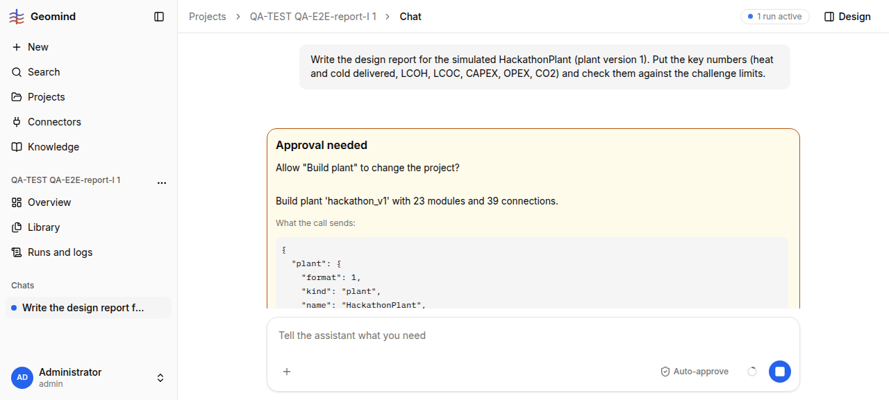

# QA-167: Report request routed as a redesign: the project lead's problem state has no plant versions, studies or results, so it plans design_lead build and simulate again (17+ min, 130+ steps)

| Field | Value |
|---|---|
| Status | fixing |
| Severity | major |
| Area | geomind |
| Reporter | QA-E2E-report-I |
| Found | 2026-11-05 17:14 UTC |
| Versions | backend 1.1.102 at the start (geomind 0.4.97), frontend bundle index-TsXgd_n9.js |
| Where | https://geomind.team/projects/0e44cb05-6096-434e-95ee-56b434898015/assistant/chat; project QA-TEST QA-E2E-report-I 1; run 3f8270d5-b11e-4c86-b3ca-b0b4d4feb61c; project_lead steps 1-5 (16:51:19-16:51:36 UTC), design_lead steps 1-6 |
| Fixer | hotfix-back-VI |

## Steps

1. Project with case, plant v1 and v2, and a done Study-page simulation of v1 (QA-165 Steps 1).
2. Chat: the report request of QA-165 Steps 2.

## Expected

A report request on a project with a finished simulation goes to the analysis lead and the
explainer with the existing result; no design work, no Build plant card.

## Actual

- The project lead's context holds "Problem state, version 1 / Case: ..." only: no plant
  versions, no studies, no results. The project lead has no `list_plants` / `list_studies` tool
  (`geomind/agents/project/lead.py`: read_case, set_case, case_changes, accept_case,
  update_state, read_stored, ask_user, teams). It also tried `read_case(section="design")`
  (refused).
- Its plan (R0): "design_lead builds/simulates the plant on the case ... reviewer verifies ...
  analysis_lead produces the key numbers, explainer writes the report".
- The design lead tries `simulate("design/HackathonPlant")` (refused: not a design of this
  chat), then `build_plant` with the plant `read_plant(plant_version=1)` returned: refused,
  `fluids.chiller_cooler: salinity Input should be a valid number, input_value=None` (read_plant
  returns `null` for fluid fields that build_plant requires), then a second build_plant with
  23 modules / 39 connections that reaches the user as an approval card whose body is raw JSON
  (screenshot 1; QA-121 asked for a one-sentence card).
- Timing: request 16:51:19; approval card 16:52:05; after my Deny 16:58:00 the run needed 135
  steps and 17 min to reach the analysis lead (1.22 M input tokens, 0.032 USD at 17:06).

## Evidence

- 
- Run steps: `../evidence/QA-167/run-3f8270d5-steps.txt`

## Cause

Fact (code read, geomind 0.4.98): `geomind/context/state.py` `render()` lists goal,
requirements, assumptions, design, results of this chat and the case; the project's plant
versions and studies (`project_designs`) are not in it, and the project lead has no tool that
reads them. Second, smaller cause: `read_plant` output is not a valid `build_plant` input (null
fluid fields).

## Fix

hotfix-back-VI, geomind 0.4.108 (242177e) in backend 1.1.107, deployed 2026-11-05 ~17:31 UTC.
The project lead gets `list_plants` and `list_studies` (the project's plant versions and studies
with results, `project_designs` of the backend Workspace since 1.1.90), and its prompt's first rule:
for a request about a design, result or report, read both first; a project with a plant version and
a study with results gets a brief to `analysis_lead` / `explainer`, never `design_lead`. The backend
part was already live (QA-122). Not done: `read_plant` output with null fluid fields is no valid
`build_plant` input (for hotfix-python).

## Retest

Recipe: on a project with a plant version and a finished study, ask in a new chat for the report;
the project lead calls list_plants and list_studies, then briefs analysis_lead/explainer; no
design_lead, no build_plant approval card.
