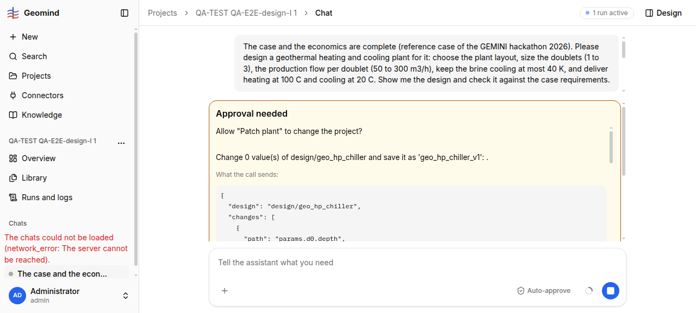

# QA-172: patch_plant approval card says 'Change 0 value(s) of design/... : .' for a patch of 99 changes (call_summary reads changes as a dict, the tool sends a list)

| Field | Value |
|---|---|
| Status | fixed |
| Severity | minor |
| Area | geomind |
| Reporter | QA-E2E-design-I |
| Found | 2026-11-05 17:07 UTC |
| Versions | frontend 1.1.113, backend 1.1.104, geomind 0.4.97 |
| Where | https://geomind.team/projects/f1704a61-f1b8-4b63-84d3-20bd30beaed7/assistant/chat/cd332dde-7afa-4865-8a75-d8f6d4be6354; run 76d19df6-485f-46ee-a182-6b03ed70ab33; every patch_plant card (request-1xx, 17:07-17:11 UTC) |
| Fixer | hotfix-python-VIII |

## Steps

1. Chat asks for a plant design (project QA-TEST QA-E2E-design-I 1, reference case loaded).
2. Approve build_plant; wait for the design lead's patch_plant card.

## Expected

The one-sentence summary (QA-121) names how many values change and which: "Change 99 value(s) of design/geo_hp_chiller and save it as 'geo_hp_chiller_v1': params.d0.depth, ...".

## Actual

Every patch_plant card reads `Change 0 value(s) of design/geo_hp_chiller and save it as 'geo_hp_chiller_v1': .` The call sends 99 changes (first card), then 7, then 1 (later cards, same text with 0). The user sees "0 values" and a list of nothing above hundreds of lines of JSON.

## Evidence

- 
- The request text (GET /api/v1/assistant/runs/76d19df6-.../ `request.message`): `Allow patch_plant (write)?\n\nChange 0 value(s) of design/geo_hp_chiller_v1 and save it as 'geo_hp_chiller_v2': .` with `"changes": [ {"path": "params.d0.well.friction_correlation", ...}, ... ]`.

## Cause

`geomind/geomind/engine/session.py:740` `call_summary`: `paths = _leaves(item.get("changes") or {})` treats `changes` as a nested dict; patch_plant's `changes` is a list of `{path, value, source, reason}` (fact: the input in the card). `_leaves` of a list gives nothing, so 0 and an empty list.

## Proposed fix

In `call_summary` for patch_plant: when `changes` is a list, `paths = [c.get("path") for c in changes if isinstance(c, dict)]`; keep `_leaves` for the dict form. Show at most ~8 paths and "and N more". A unit test with a list-form patch.

## Fix

- 2026-11-05 17:27 UTC: geomind 0.4.105, commit d687b9d, deployed: patch_plant card counts list changes
## Retest
