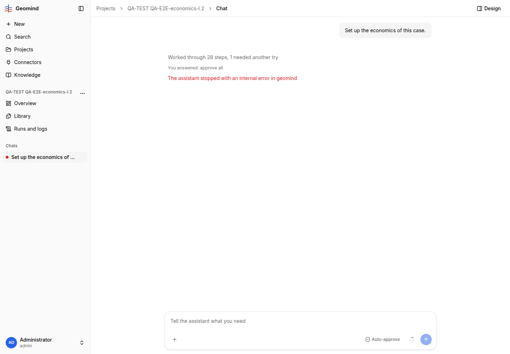

# QA-181: Economics approve all ends the run: ask_economics is effect read, so the repeat guard serves stale read_case/case_changes and stops the run

| Field | Value |
|---|---|
| Status | open |
| Severity | blocker |
| Area | geomind |
| Reporter | QA-E2E-economics-I |
| Found | 2026-11-05 17:13 UTC |
| Versions | frontend 1.1.114, backend 1.1.104 (geomind 0.4.102 c5ed1b1, local wheel) |
| Where | https://geomind.team/projects/8ac1457c-8962-4425-b04a-8324af087473/assistant/chat; project "QA-TEST QA-E2E-economics-I 2"; run 2d5ced06-9627-4fa6-80cd-c61e6bbf6fa9; case lead steps 6-8, project lead steps 5-8 |
| Fixer | hotfix-python-VIII |

## Steps

1. New project; reference `gemini/examples/hackathon_2026/case.json` loaded by API without its
   `economics` (plus `data/demand.csv`). Case complete, economics unset.
2. Chat: "Set up the economics of this case." (17:11:41 UTC).
3. The economics question card arrives at 17:12:52 (1 min 11 s). Press **approve all** (17:13:01).

## Expected

`ask_economics` sets the approved values (it does), the case lead reads them back once, the
project lead sees the economics change and the run ends with a summary.

## Actual

The run fails at 17:13:31 with "The assistant stopped with an internal error in geomind" (chat).
Run error: `case_changes: the same call as an earlier successful one was sent in 3 steps in a row;
the run stops instead of spending more`.

- Case lead step 6 `read_case {"section":"economics"}` gets the repeat note: "the same call as
  step 1, and nothing was written since, so it did not run again: ... the case does not set
  'economics' yet". The economics WERE written by the approve all one step earlier. Steps 7 and 8
  repeat the same (stale "unset" each time).
- Project lead steps 5-8 call `case_changes {}` four times; each gets the repeat note with the
  stale result `[]` (no change), so the lead loops and the guard stops the run.
- The economics are in fact stored (case version 3, `economics.json`); only the run fails.

Same root in run bf3990c4 (project "QA-TEST QA-E2E-economics-I 1", 16:53:34 UTC, step 8): after
"approve all, with three changes" the case lead's `read_case economics` got the stale "unset"
note; that run recovered only because the next `set_case` (a real write) reset the guard.

Speed: request to card 71 s (case lead 7 steps; step 5 `ask_economics` LLM call 33 s, 5676 output
tokens). Run cost 0.008 USD, 435k input tokens.

## Evidence

- 
- Run JSON (failed run): `../evidence/QA-181/run-2d5ced06.json.gz`
- Run JSON (project 1, stale read at step 8): `../evidence/QA-181/run-bf3990c4.json.gz`

## Cause

Fact: `geomind/tools/gemini/economics.py:640` declares `@tool(effect="read", runs_alone=True)` on
`ask_economics`, but its `on_answer` (approve all) writes the economics into the case
(`geomind/engine/step.py` `answered_result`). `same_result` in `geomind/engine/step.py:160-185`
only reruns a pure call when a non-pure tool succeeded since; `ask_economics` counts as pure, so
the write is invisible to the guard: `read_case` and `case_changes` are answered from their
results before the write, and `_over_retries` stops the run.
Guess: `case_changes` also misses the economics change because the write does not go through the
path that records case changes (it returned `[]` in step 3 of the project lead, before the answer).

The chat text "internal error in geomind" is wrong for a guard stop (`code: error`); a user reads
it as a crash.

## Proposed fix

1. geomind `economics.py`: give `ask_economics` a write effect (e.g. `effect="write"`, keeping
   `runs_alone=True`), or have the engine treat any tool with `on_answer` that wrote as a write in
   `same_result` (mark the succeeded entry as not pure when `on_answer` changed the case).
2. Make the approve-all write register as a case change, so the project lead's `case_changes`
   lists the economics keys.
3. Optional (frontend/backend): show a guard stop as "stopped: the same call was repeated"
   instead of "internal error in geomind".

## Fix

- 2026-11-05 17:27 UTC: geomind 0.4.103, commit 1f8c2c8, deployed (backend 1.1.106): an answered question with on_answer counts as a write in same_result, so read_case/case_changes run again after approve all
- 2026-11-05 17:33 UTC: retest 17:32 UTC on backend 1.1.106 / geomind 0.4.106 still fails (run 92e9d156): answered ask_economics has source 'answer', recovery.py skips it in succeeded, so _may_write never sees it; see Retest
## Retest

- 2026-11-05 17:32 UTC, QA-E2E-economics-I: **FAILS** on backend 1.1.106 (celery has geomind
  0.4.106, `step._may_write` present). Project "QA-TEST QA-E2E-economics-I 4"
  (7d1d7b7c-96bb-403a-b0d1-5a88aec22466), run 92e9d156-a3a4-41c1-bb77-c9a03ff40a9b: "Set up the
  economics of this case." -> card at 17:31:59 -> approve all 17:32:05 -> failed 17:32:29, same
  chat text "internal error in geomind", run error `read_case: the same call as an earlier
  successful one was sent in 3 steps in a row`. Case lead steps 9-10 and project lead steps 4-6
  get the stale "economics unset" / `case_changes []` notes again.
  Cause (fact, from the code): the answered call is recorded with `source="answer"`
  (`engine.py:417` `record_result(..., source="answer")`), and `_remember_succeeded` in
  `engine/recovery.py:161` returns early for `event.source != "tool"`, so `ask_economics` never
  enters `state.succeeded`; `_may_write` therefore never sees it. Fix: append answered calls
  (source "answer") to `succeeded` too (or mark the state "written" when `on_answer` ran), and
  check the same for the project lead, whose `read_case`/`case_changes` after the case lead's
  nested run also stay stale. Evidence: `../evidence/QA-181/retest-1.png`,
  `../evidence/QA-181/run-92e9d156.json.gz`.
