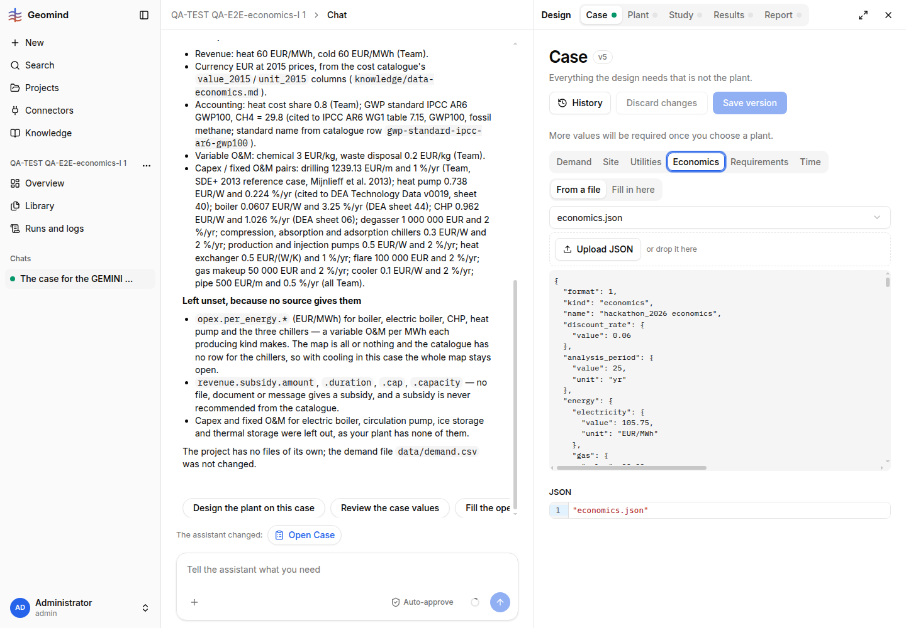
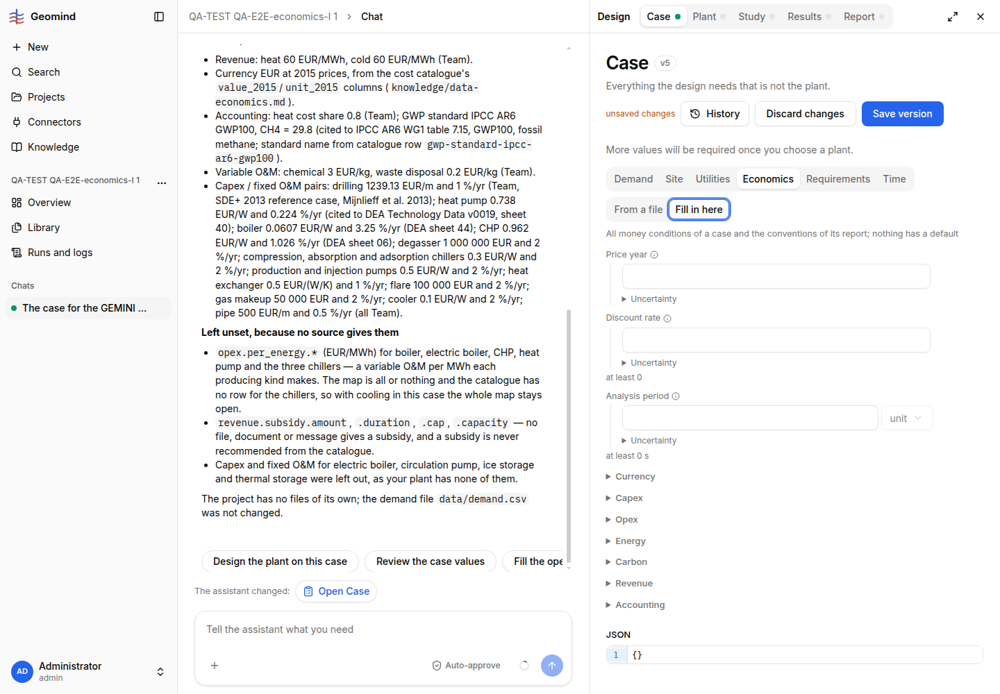

# QA-185: Case > Economics: economics set by chat is a file; 'Fill in here' opens an empty form with unsaved changes, so Save version would wipe the economics; values and sources are only raw JSON

| Field | Value |
|---|---|
| Status | open |
| Severity | major |
| Area | frontend |
| Reporter | QA-E2E-economics-I |
| Found | 2026-11-05 17:11 UTC |
| Versions | frontend 1.1.114 (bundle index-Co1lDzOn.js), backend 1.1.104 (geomind 0.4.102) |
| Where | https://geomind.team/projects/e4a51b01-9faf-4bbc-819e-2223ef3d9e7b/design/case, tab Economics; project "QA-TEST QA-E2E-economics-I 1", case v5 |
| Fixer | |

## Steps

1. Let the assistant set the economics in chat (run bf3990c4; it stores them as the case file
   `economics.json`, case `"economics": "economics.json"`).
2. Open Design > Case > Economics. It opens on "From a file": a file picker set to
   `economics.json` and the file's raw JSON (screenshot 1).
3. Click "Fill in here".

## Expected

The Economics tab shows the values the agents set in the form (price year, discount rate,
analysis period, Capex, Opex, Energy, Carbon, Revenue, Accounting), each with its source from
`about.sources`, whether the economics are inline or in `economics.json`. Switching the view never
changes the case by itself.

## Actual

- "Fill in here" shows an EMPTY form (Price year, Discount rate, Analysis period blank; JSON `{}`)
  and the page at once says "unsaved changes" with "Save version" enabled (screenshot 2). One
  click on Save version would replace the 30+ economics values with `{}`. (I pressed Discard.)
- In "From a file" the only view is the raw JSON text of the file; the sources the agents recorded
  (`about.sources`, one per key) are not shown as sources, and a user cannot check a value
  against its source without reading JSON.
- The same happens for every project whose economics the assistant set (the assistant always
  writes `economics.json`).

## Evidence

- 
- 

## Cause

Guess: the "Form of the value" toggle treats `economics` as either a file name or an inline
object; switching to "Fill in here" replaces the string `"economics.json"` with a new empty object
instead of loading the file's content into the form.

## Proposed fix

frontend (Case page, economics section): when `economics` is a file name, load that file
(`GET /design/case/files/economics.json`) into the form, read-only or editable, and show each
key's `about.sources` entry next to it; "Fill in here" should start from the file's content, not
from `{}`; a view switch alone must not mark the case dirty.

## Fix

## Retest
