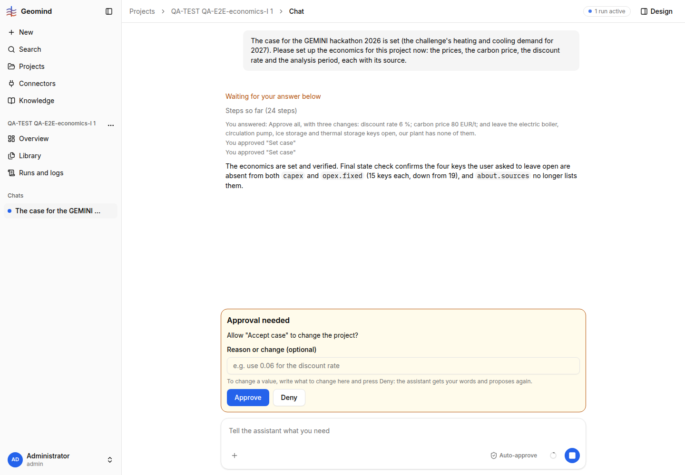

# QA-193: Chat approval card: Approve/Deny sit below a long JSON inside a 45svh scroll box; 'Accept case' card says nothing about what it does

| Field | Value |
|---|---|
| Status | fixed |
| Severity | minor |
| Area | frontend |
| Reporter | QA-E2E-economics-I |
| Found | 2026-11-05 17:05 UTC |
| Versions | frontend 1.1.114, backend 1.1.104 |
| Where | https://geomind.team/projects/e4a51b01-9faf-4bbc-819e-2223ef3d9e7b/assistant/chat/01f6cabc-e78c-4227-844e-a9f78e4106b1 (run bf3990c4), viewport 1440x1000 |
| Fixer | hotfix-front-VII |

## Steps

1. A run asks to approve `set_case` with a JSON patch of ~30 lines (economics changes).
2. Look for Approve.
3. Later the same run asks to approve "Accept case".

## Expected

Approve and Deny always visible (sticky at the card's bottom), the JSON scrolls. Every approval
says in one sentence what it will do.

## Actual

- The card (`RunRequest` in `frontend/src/domains/assistant/chat/workspace.tsx`, box
  `max-h-[45svh] overflow-y-auto`) holds the JSON and, below it, the reason box and the buttons.
  At 1440x1000 the Approve button is at y=1062, outside the window and inside the inner scroll
  box (screenshot 1). A user must scroll inside the card to find it; nothing shows that buttons are
  below. The automated browser's click on Approve did nothing until the box was scrolled (run
  waited 13 min, 16:53-17:06 UTC; partly my tool, but it shows the buttons are hidden).
- The "Accept case" card shows only "Allow 'Accept case' to change the project?" and an empty
  body, no sentence on what is accepted (screenshot 2).

## Evidence

- 
- 

## Cause

Fact: the buttons are inside the same overflow box as the JSON. The "Accept case" request carries
no summary text (geomind `accept_case` approval text, cf. QA-121 one-sentence cards).

## Proposed fix

frontend `request-card.tsx` `Approval`: put the JSON in its own `max-h` scroll area and keep the
reason box and Approve/Deny outside it, always visible. geomind: give `accept_case` an approval
sentence ("Make the case you approved the project's case: economics v3 -> v5").

## Fix

frontend 1.1.117 (commit b5ab7ef, bundle index-CnfyoHnO.js): the card (`request-card.tsx`) is a flex column inside the 45svh box (`workspace.tsx`); only the request text and JSON (`RequestMessage`) shrink and scroll, the reason box and Approve/Deny stay visible. An `accept_case` request with no text of its own gets one sentence in the frontend ("It keeps the case with the changes you approved as the case you gave ..."). The geomind approval sentence (with versions) is still open for hotfix-python if wanted.
- 2026-11-05 17:24 UTC: frontend 1.1.117, commit b5ab7ef
## Retest

Not run (no tests now). Retest: a set_case approval with a long JSON at 1440x1000 shows Approve without scrolling.
