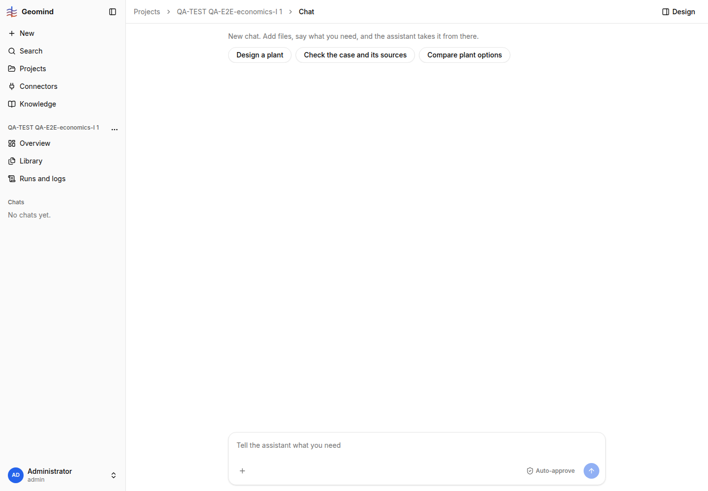

# QA-194: Next-step chips on a project whose case has no economics offer 'Design a plant' and nothing for the economics

| Field | Value |
|---|---|
| Status | verified |
| Severity | minor |
| Area | backend |
| Reporter | QA-E2E-economics-I |
| Found | 2026-11-05 16:50 UTC |
| Versions | frontend 1.1.114, backend 1.1.102 / 1.1.104 |
| Where | https://geomind.team/projects/e4a51b01-9faf-4bbc-819e-2223ef3d9e7b/assistant/chat (empty chat), and project "QA-TEST QA-E2E-economics-I 2" |
| Fixer | |

## Steps

1. Project whose case is complete (no missing, no problems) but has no `economics`.
2. Open the chat.

## Expected

A chip for the step the project needs next: "Set the economics" (memory rule: suggestions follow
the project state, never generic).

## Actual

Chips: "Design a plant", "Check the case and its sources", "Compare plant options"
(screenshot 1). Nothing names the economics; a cost-based design or study later stops on the
missing economics. After the economics run, the chips did offer "Fill the open economics", so the
state is known at that point.

## Evidence

- 

## Cause

Fact: `geomind/geomind/tools/suggestions.py` `stage_of` / `project_stage` go from "case" to the
plant stage on case state alone; `STAGES["case"] = ("design_plant", "check_case",
"compare_options")` has no economics step, and the `economics` step ("Costs and economics") is
only in the "plant" stage.

## Proposed fix

geomind `suggestions.py`: when the case is ready but `economics` is unset (or has open keys the
case's plants need), put an economics step first in the "case" stage ("Set the economics", message
"Set up the economics of this case.").

## Fix

- 2026-11-05 18:57 UTC: deploy 36: backend 1.1.118, geomind 0.4.130, gemini 0.6.26 (hotfix-python-lead-II)
- 2026-11-05 18:59 UTC: retest 19:00 UTC fails: empty chat has no problem state and the project progress has no economics item; backend should add it (see Retest)
## Retest

- 2026-11-05 19:00 UTC, QA-E2E-economics-I: **FAILS** on backend 1.1.118 (geomind 0.4.130). New
  project "QA-TEST QA-E2E-economics-I 9" (a2d1d833-beb5-4216-b2f7-4bb4d40f50fb), case complete, no
  economics; the empty chat still shows "Design a plant", "Check the case and its sources",
  "Compare plant options" after a reload (`../evidence/QA-194/retest-1.png`).
  Cause (fact): `project_steps` adds `set_economics` only when `economics_unset(problem, project)`
  is true; an empty chat has no problem state, and the project's progress from the API
  (`GET /workspace/projects/{id}` -> `progress`) has only case, plant, study, results, report: no
  `economics` item, so "unknown is not unset" and no chip. Fix: backend adds an `economics` item
  to the project progress (unset / ready from the latest case version), or `economics_unset`
  reads the project's latest case when the chat has no state.
- 2026-11-05 19:29 UTC, QA-E2E-economics-I: PASSES on backend 1.1.122. New projects "QA-TEST
  QA-E2E-economics-I 12" and "13" (case complete, no economics): the empty chat shows "Set the
  economics" first, then "Design a plant", "Check the case and its sources"
  (`../evidence/QA-194/retest-2.png`).
- 2026-11-05 19:28 UTC: QA-E2E-economics-I 19:29 UTC backend 1.1.122: empty chat shows 'Set the economics' first
