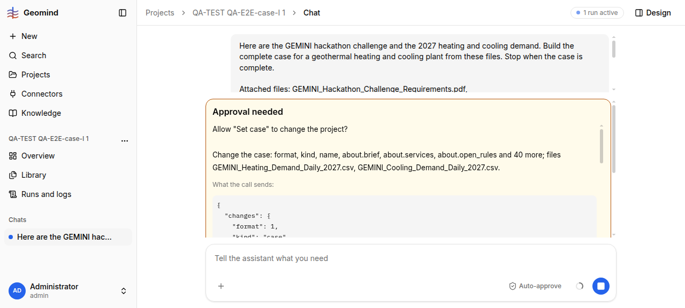

# QA-196: Approval card cuts the call's JSON at 1500 chars and says 'the whole input is in the run log', but a pending call is in neither the run log nor /calls/{id}

| Field | Value |
|---|---|
| Status | open |
| Severity | minor |
| Area | geomind |
| Reporter | QA-E2E-case-I |
| Found | 2026-11-05 17:21 UTC |
| Versions | frontend 1.1.113, backend 1.1.102 (geomind 0.4.97) |
| Where | https://geomind.team/projects/9a3f8f4b-8a49-446d-b665-8eb1dbb92709/assistant/chat; project QA-TEST QA-E2E-case-I 1; chat c95772fb; run cf319cd4; call call-dae174e5-5c59-41c7-aef3-cc156ef95097 (case_lead step 10, set_case) |
| Fixer | |

## Steps

1. New project, upload the challenge PDF and the two demand CSVs, ask for the complete case.
2. The case lead's first good `set_case` (46 changed leaves) asks for approval.
3. Read the card: "What the call sends" stops after ~1500 characters (inside `site.reservoir.permeability`) with
   "... (cut; the whole input is in the run log)".
4. Look for the whole input while the card waits: `GET /assistant/runs/cf319cd4.../log` (last step,
   case_lead 10, has `tool_calls: []` and an empty answer) and `GET /assistant/runs/cf319cd4.../calls/call-dae174e5...`
   (404 `call_not_found`). `GET /assistant/runs/{id}` gives `request.message`, the same cut text.

## Expected

The user can read every value of the call before approving it: the card shows the whole input (folded
JSON, or a scroll), or the run log / the calls endpoint already hold the pending call, as the card says.

## Actual

The card hides about 2/3 of the call (demand, requirements, utilities of 46 leaves were not visible)
and sends the user to a place where the input is not yet written: the call is logged only after it ran,
i.e. after the approval. The user approves values they cannot see. Same on the requirements card
(cut after `cold_delivered`) and in project 2 (`p2-card3`, utilities cut).

## Evidence

-  (card at 16:52:58 UTC, cut JSON, 577 px tall window)
- `../evidence/QA-196/card-message-run-cf319cd4.txt`: the whole `request.message` (1770 chars, cut at 1500 of JSON)
- 404 body of /calls: `{"error":{"code":"call_not_found","message":"Run cf319cd4-... has no tool call call-dae174e5-..."}}`
- Speed: no extra time, but the user cannot check values: S3 "change some" is blind.

## Cause

Fact: `geomind/geomind/engine/session.py:765-778` `approval_message` cuts `json.dumps(tool_input)` at
`APPROVAL_INPUT_CHARS = 1500` (line 697) and appends the run-log pointer. The run log writes a tool call
only when it has its output, so a pending call is not there.

## Proposed fix

geomind `engine/session.py`: put the whole input in the approval request as a separate field
(e.g. `request.input`, not cut) and keep only the message short; frontend shows that field folded (JSON
viewer as on the Case page). Or the backend `/runs/{id}/calls/{call_id}` returns the pending call's input
from the run's `request`. At least change the text to point to a place that has it.

## Fix

- 2026-11-05 18:39 UTC: QA-E2E-case-I 18:39 UTC, backend 1.1.116: the set_case card of project QA-TEST QA-E2E-case-I 6 lists every leaf (path: value unit, 60+ lines), nothing cut: looks resolved by another change; fixer please confirm and close
## Retest
