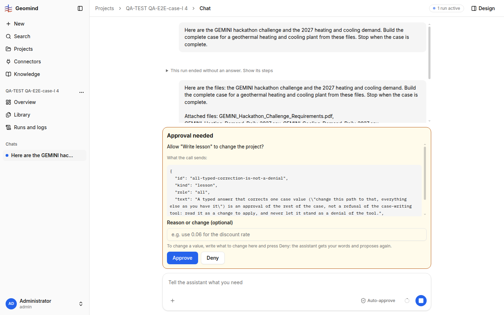

# QA-230: Deny with a change (the card's own way to change a value) blocks set_case for the whole request: 17 refused calls, the case is never written

| Field | Value |
|---|---|
| Status | open |
| Severity | blocker |
| Area | geomind |
| Reporter | QA-E2E-case-I |
| Found | 2026-11-05 17:39 UTC |
| Versions | frontend 1.1.113, backend 1.1.105-1.1.107 (geomind 0.4.100+) |
| Where | https://geomind.team/projects/290484c7-3c42-46be-bba5-20444b2bb307/assistant/chat; project QA-TEST QA-E2E-case-I 4; run 679f3555 |
| Fixer | |

## Steps

1. New project, PDF + 2 CSVs, "Build the complete case ... Stop when the case is complete."
2. Confirmation question (17:31:27 UTC, 4 min 11 s after sending): approve all.
3. The set_case approval card (17:32:11) says: "To change a value, write what to change here and press
   Deny: the assistant gets your words and proposes again." Type
   "Change: demand.heating.return_temperature = 55 °C instead of 60. Everything else as you have it." and press Deny (17:32:18).

## Expected

The case lead gets the words, proposes set_case again with 55 °C, a new card comes, approve, case stored.

## Actual

The QA-116 guard (`earlier_denial`, geomind engine/session.py) treats this denial as "the user denied
set_case for this request": every later set_case is refused without a card:
"set_case: the user denied this tool earlier in this request (...), so it is not asked again".
- case_lead 10-12: 3 refused; it asks an extra question "shall I now write the whole case with 55 °C?" (17:33:00);
  answer "yes, write the case with 55 °C" (17:33:42);
- case_lead 15-20: 4 more refused; project_lead re-delegates the case lead (2nd instance): 7 more refused;
  project_lead tries set_case itself: refused. **17 refused set_case calls**, 2 case-lead delegations, 1 extra question.
- 17:33:42 to 17:38:24 (4 min 40 s) with no result; then the curator starts (lesson cards).
- No case: `GET /design/case?project=290484c7...` 404 at 17:38 UTC.

This is the only change path the approval card offers (QA-073: no edit in place), so any change made on a
set_case card kills the case for the request. Same for any write tool (patch_plant, set_economics ...).

## Evidence

- Run log `../evidence/QA-230/run-679f3555-log.json.gz`: case_lead 9 (the deny), 10-20, project_lead 6 and 10.
- 

## Cause

Fact: `earlier_denial` (geomind/geomind/engine/session.py ~781) returns the last user denial of the tool
in the request tree, with or without a reason, and `denied_again` refuses the call. QA-116 meant a plain
"no"; a denial whose reason asks for a change is a "change and propose again".

## Proposed fix

geomind engine/session.py: a denial WITH a reason is not a block; only a denial without reason (or a reason
the model classifies as refusal) holds for the request. Or the frontend sends a separate decision
"change" (button "Send change") for the reason box, which the guard ignores. Also the lead's prompt:
after a change-denial, propose again with the change.

## Fix

## Retest
