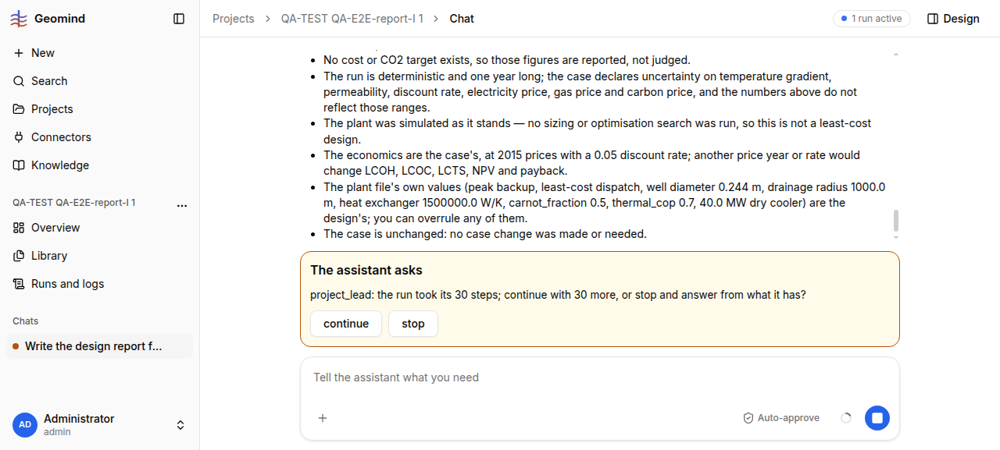

# QA-233: Report finish refused 3 times: 'result is stale: it ran another plant than design/v1' for a fresh simulate of design/v1 (false positive), run loops to 349 steps and asks the user to continue

| Field | Value |
|---|---|
| Status | open |
| Severity | major |
| Area | geomind |
| Reporter | QA-E2E-report-I |
| Found | 2026-11-05 17:42 UTC |
| Versions | backend 1.1.104-1.1.106 during the run (geomind 0.4.98-0.4.106; the run resumed over deploys), frontend bundle index-TsXgd_n9.js |
| Where | https://geomind.team/projects/0e44cb05-6096-434e-95ee-56b434898015/assistant/chat/b31664b0-44c2-4d20-9ee7-987f592b5aff; run 3f8270d5-b11e-4c86-b3ca-b0b4d4feb61c; project_lead finish calls 17:22-17:39 UTC |
| Fixer | hotfix-python-lead |

## Steps

1. QA-165 steps (report request on a project with plant v1/v2 and a page simulation of v1).
2. The design lead builds `design/v1` from `read_plant(plant_version=1)` and simulates it
   (`result/9b0db55da13a4a5b`, later `result/9d5039b3a5919695`); the reviewer records
   `verification.result` and gemini's verdict: feasible, 15/15 passed.
3. The project lead calls `finish` with the report.

## Expected

`finish` accepts: the result was simulated from `design/v1` itself, in this run, on the current case.

## Actual

`finish` refuses 3 times (lines 661, 745, 792 of the steps file):
`verification: result/9b0db55da13a4a5b is stale: it ran another plant than design/v1; simulate
the current design and check it` and then the same for the second fresh simulation
`result/9d5039b3a5919695`. The leads re-simulate and re-review again (design_lead, reviewer
called 3-4 times each), then the project lead hits its 30-step limit and asks the user
"the run took its 30 steps; continue with 30 more, or stop?" (QA-086 was fixed for the design
lead; here it is the project lead). The final answer opens with a caveat that "the app's own
finish check keeps rejecting the stored result".

Speed and cost of the whole report request: 16:51:19 to 17:39:57 UTC = 48.6 min, 349 steps,
5.44 M input tokens, ~0.15 USD (run.usage). Of this ~17 min (17:22-17:39) are this loop.
Accuracy: the final numbers are right (equal to the page study of v1 to every digit:
CAPEX 34.636 MEUR, LCOH 43.753, LCOC 51.445, LCTS 45.102 EUR/MWh, CO2 13.774 kt).

## Evidence

- 
- Run steps: `../evidence/QA-233/run-3f8270d5-steps.txt` (search "stale")
- Final chat answer text: `../evidence/QA-233/chat-answer.txt`

## Cause

Fact: the message comes from `geomind/verify/design.py` `verify_design`:
`plant.to_dict(structure=True) != context.session.load_artifact(design)`.
Guess: for a design built from a project plant version (`read_plant(plant_version=1)` with
`null` fluid fields, QA-167), the stored `design/v1` artifact and the plant gemini rebuilds from
the run differ in form (nulls, defaults filled, key order of fluids/params), so the equality
never holds even for the same plant.

## Fix

Proposal (geomind, hotfix-python): compare a canonical form (both sides through
`gm.Plant.from_dict(...).to_dict(structure=True)`) or a digest stored with the result at
simulate time (`{result}.design` = the design reference and its digest), and test it with a
design built from a project plant version. Also: the project lead should not hit a 30-step
ask on a report (raise its budget or drop the ask with Auto-approve, as QA-086 did for the
design lead).
- 2026-11-05 18:09 UTC: deployed 19:01-19:03 CET: backend 1.1.112, geomind 0.4.118/0.4.119, gemini 0.6.19 (hotfix-python team)
- 2026-11-05 18:27 UTC: deployed by 19:22 CET: backend 1.1.115, geomind 0.4.123, gemini 0.6.21 (hotfix-python team)
- 2026-11-05 19:28 UTC: retest run 12115d92: finish refuses the page result as result_off_case (false), re-simulate loop, 26 min
## Retest

QA-E2E-report-I, 2026-11-05 19:30 UTC, project QA-TEST QA-E2E-report-I 3 (a9ff33c4), run 12115d92 (19:00:07-19:26:29 UTC), backend 1.1.118 at the start (1.1.122 at the end): STILL FAILS, other branch of the same check. The explainer's report on the page result was done at ~19:13 UTC; `finish` refused it: "verification: result/f9e1024c-50b8-4037-9340-567b602059df ran on another case than the problem state's; simulate the design on the state's case and check it again" (result_off_case in `geomind/verify/design.py`), although the page result ran on case v3 and the state's case is v3 (no case change in this project). The leads then re-simulate design/v1 (result/9b0db55da13a4a5b), re-review and re-write the report: 26 min 22 s, 114 steps, 3.96 M input tokens, 0.091 USD for a report whose numbers were ready at ~13 min. The final text still says "nothing was ... re-simulated for this report", which is no longer true. Numbers correct (equal the page result). Guess: `result_off_case` compares the session artifacts `<built-in function id>.case` / `<built-in function id>.files` that a project result never has, so every project result counts as off-case. Evidence: `../evidence/QA-233/run-12115d92-steps.txt` (line 258), `../evidence/QA-233/2.png`. Reopened.
