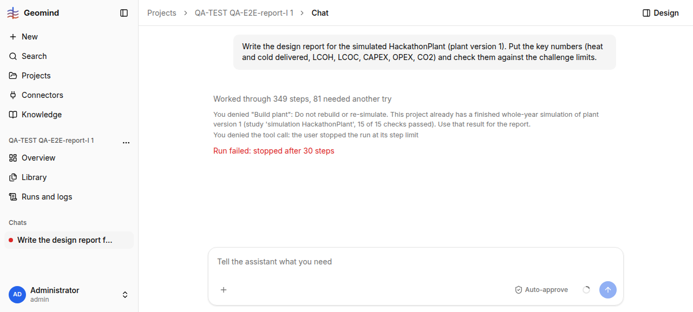

# QA-242: Answering 'stop' to the step-limit question marks the run failed (step_limit) and the chat 'failed', although the report answer was delivered

| Field | Value |
|---|---|
| Status | fixing |
| Severity | minor |
| Area | backend |
| Reporter | QA-E2E-report-I |
| Found | 2026-11-05 17:50 UTC |
| Versions | backend 1.1.106 at the answer (geomind 0.4.106), frontend bundle index-TsXgd_n9.js |
| Where | https://geomind.team/projects/0e44cb05-6096-434e-95ee-56b434898015/assistant/chat/b31664b0-44c2-4d20-9ee7-987f592b5aff; run 3f8270d5-b11e-4c86-b3ca-b0b4d4feb61c |
| Fixer | hotfix-back-lead |

## Steps

1. A report run reaches the project lead's 30-step question "continue with 30 more, or stop and
   answer from what it has?" (QA-233), with the full report already shown above the card.
2. Click "stop" (17:40:40 UTC).

## Expected

"stop" is the user's choice: the run ends `done` (or `stopped`) with the answer it has; the chat
list shows it as done; next-step chips appear under the answer.

## Actual

Run status `failed`, `error = {"code": "step_limit", "message": "stopped after 30 steps"}`,
ended 17:40:48 UTC; the chat list shows "failed · 17:51"; no next-step chips under the answer
(screenshot 1). Totals: 216 steps, 365 tool calls, 5.44 M input tokens (3.41 M cached),
0.152 USD.

## Evidence

- 
- Run record: `../evidence/QA-242/run-3f8270d5.json`

## Cause

Guess: the backend (or geomind's loop) maps the "stop" answer of a step-limit question to the
step_limit error path instead of a normal finish with the last answer.

## Fix

Proposal: on "stop", end the run as `done` with the answer it has (status note "stopped by the
user at the step limit"), and emit the finish suggestions. Backend runs service or geomind's
step-limit handling (whichever raises `step_limit` after an answered question).

## Retest

(Who, when, result.)
