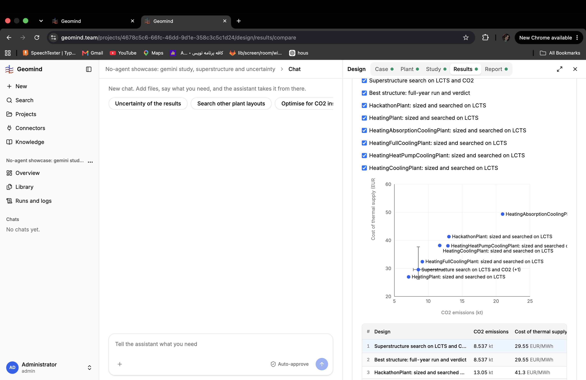

# QA-244: Results compare: depth shown raw (3281.9831696449164 m), Doublets '-' for the superstructure result (2 doublets), point labels overlap, 'dashed trade-off line' text but no line drawn

| Field | Value |
|---|---|
| Status | fixing |
| Severity | minor |
| Area | frontend,backend |
| Reporter | Sahand (screenshot), Manual QA-IV |
| Found | 2026-11-05 17:45 UTC |
| Versions | backend 1.1.109, frontend live 2026-11-05 17:42 UTC |
| Where | https://geomind.team/projects/4678c5c6-66fc-46dd-9d1e-358c3c5c1d24/design/results/compare |
| Fixer | hotfix-front-lead |

## Steps

Open Results, Compare, with 8 results (6 minimize, 1 evolve, 1 run), axes CO2 and Cost of thermal supply.

## Expected

Depth rounded (3,282 m); Doublets 2 for the superstructure result; readable point labels; the dashed trade-off line drawn when the text names it.

## Actual

- Table: Depth `3281.9831696449164 m`.
- Doublets `-` for "Superstructure search on LCTS and CO2" and its run (the result has d0 and d1; `doublets` is null in GET /design/results/{id}).
- Labels of HeatingCoolingPlant and HeatingHeatPumpCoolingPlant are drawn on top of each other.
- "The dashed line is the trade-off line." but no dashed line is visible.
- HeatingPlant (no cooling) sits as the cheapest point (see QA-239).

## Evidence

- 

## Fix

hotfix-back-lead, backend 1.1.111: `design_facts` counts the `Doublet` modules when the plant has no class size (`counted_doublets`).
- 2026-11-05 18:05 UTC: backend 1.1.111
- 2026-11-05 18:29 UTC: Sahand 18:28 UTC: labels still overlap and are cut at the right edge; top priority
## Retest

Recipe: Compare a superstructure result with d0, d1: doublets shows 2.

## Retest 2026-11-05 18:28 UTC (Sahand, screenshot 2)

Still broken: labels overlap ("HeatingHeatPumpCoolingPlant ..." and "HeatingCoolingPlant ..." on top of each other, "Superstructure ... (+1)" and "HeatingPlant ..." crossing the error bars) and run past the right edge of the chart ("HeatingAbsorptionCoolingPl", "searched c"). Suggested fix: number the points (1, 2, 3 ... as in the table below) or show a short name (the plant name without the study suffix) and put the full names in the table; place labels to avoid collisions or show them on hover only.

