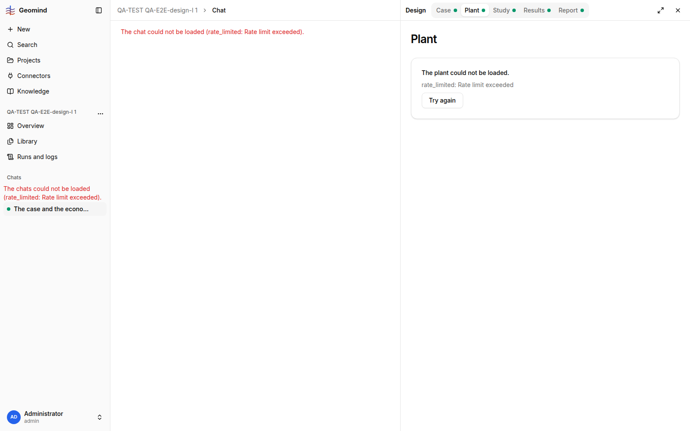

# QA-246: One browser tab gets 429 rate_limited (56 requests in a few minutes, ~17:38 UTC) and the Plant page shows 'The plant could not be loaded. rate_limited': the chat page alone fires bursts of the same GET (20x runs?status=active at once), over the 100 requests/min token bucket

| Field | Value |
|---|---|
| Status | fixed |
| Severity | major |
| Area | frontend |
| Reporter | QA-E2E-design-I |
| Found | 2026-11-05 17:38 UTC |
| Versions | frontend 1.1.113 (index-TsXgd_n9.js), backend 1.1.107-1.1.108 |
| Where | https://geomind.team/projects/f1704a61-f1b8-4b63-84d3-20bd30beaed7/design/plant (chat pane open beside it); one agent-browser tab, one sign-in |
| Fixer | hotfix-front-lead |

## Steps

1. Sign in once; open a project chat with a run (run 76d19df6) and the Design pane (Plant, Results).
2. Move between the Plant and Results tabs after the run, with the chat open.

## Expected

A single tab stays far below the per-token limit (100 requests / 60 s, `backend/src/core/ratelimit/middleware.py`, one bucket per access token since QA-024) and every page loads.

## Actual

- The Plant pane showed "The plant could not be loaded. rate_limited: Rate limit exceeded" with "Try again" (screenshot). The tab's network log had **56 responses 429** in a few minutes: design/results, chat messages, chat list, runs/{id}/agents, runs/{id}.
- At 16:53 the chat tab's log already had **20 identical GET /assistant/runs?project=...&status=active** with the same timestamp tick (27651.338-27651.347), i.e. one burst of the same query (evidence file).
- Only this tab used this token (my API scripts sign in separately and poll every 10-20 s with their own token).

## Evidence

- 
- `../evidence/QA-246/network-chat-tab-1653.txt`: the chat tab's request log (20 identical status=active calls in one tick).

## Cause

Guess: several components each run their own query for active runs / run state (and refetch on focus or on every stream event) without a shared query key or a minimum stale time; the burst plus the Design pane's own reads go past 100 per minute.

## Proposed fix

Frontend: one shared TanStack query per resource (`runs?status=active`, run state, agents) with `staleTime` of a few seconds; refetch from the SSE stream at most once per event batch; back off on 429 using `Retry-After` instead of showing an error. Backend (optional): 429 only after a higher burst for GETs of the same user.

## Fix

frontend 1.1.122 (commit ea98520, bundle index-DbPhHg2A.js). Cause (from code): `use-run-view.ts` invalidated queries on every stream event (chats on each request/run.started, run agents on each step.finished/tool.finished/run.finished, the whole project on the root run.finished), and the stream replays from event 0 on every mount, so one long run gave hundreds of invalidations per mount; each invalidation cancels the in-flight request and sends it again (TanStack `cancelRefetch`), which made bursts of identical calls (>1000/min per back-lead). Now the keys are collected and invalidated at most once per 2 s with `cancelRefetch: false`. `query-client.ts`: a 429 is retried with backoff (5/10/20/40 s) instead of failing the page.
- 2026-11-05 17:53 UTC: frontend 1.1.122, commit ea98520
## Retest

Not run (no tests now). Retest: open a chat with a long finished run plus the Design pane; the network log stays far below 100 requests a minute.

## Retest
