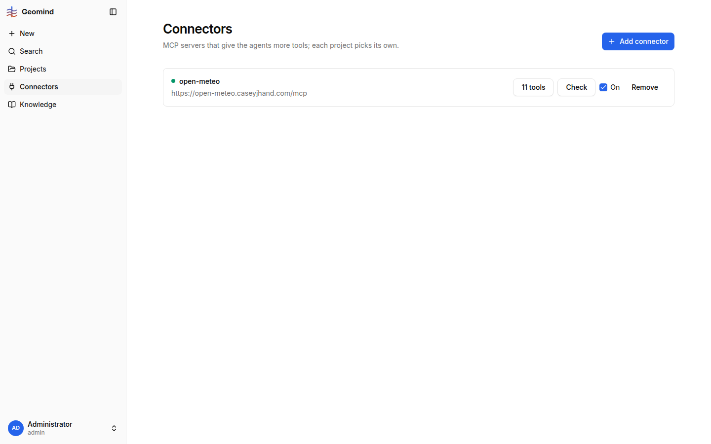
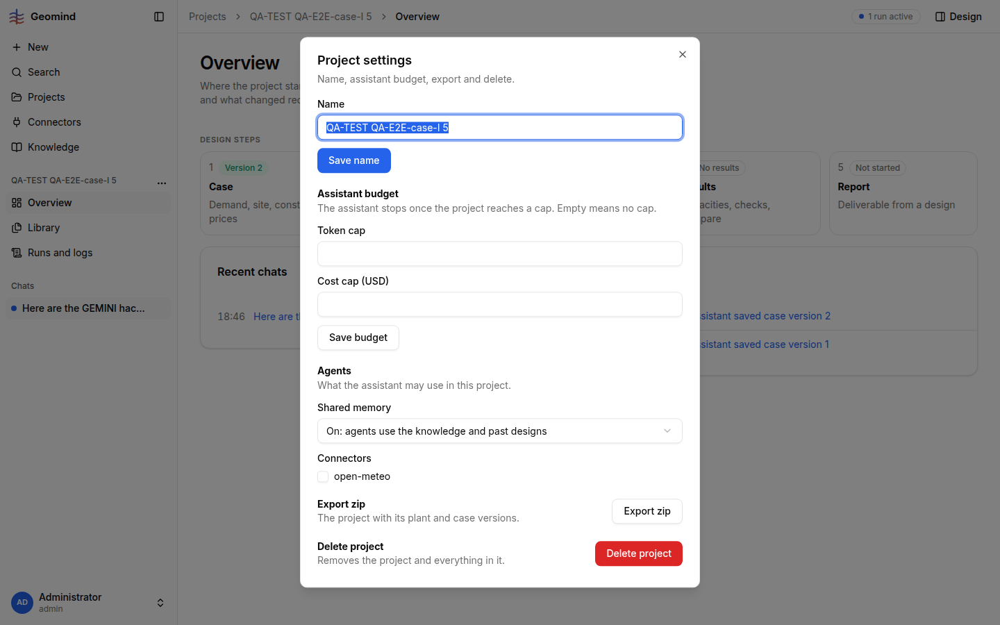

# QA-255: Connectors are off in every new project (Settings checkbox, not in the New project dialog): open-meteo is 'connected, On' but the case agents get no MCP tool, say 'No MCP server is connected' and fall back to raw web reads; the air series is lost

| Field | Value |
|---|---|
| Status | fixed |
| Severity | major |
| Area | frontend |
| Reporter | QA-E2E-case-I |
| Found | 2026-11-05 18:01 UTC |
| Versions | frontend 1.1.113, backend 1.1.107-1.1.110 (geomind 0.4.10x) |
| Where | https://geomind.team/projects/97086da0-00ed-4da1-899d-424a14f4d65d; project QA-TEST QA-E2E-case-I 5 (run c17ca5fb) and 6 (80139e85, run 3bb1de01) |
| Fixer | hotfix-front-lead |

## Steps

1. Connectors page: open-meteo "connected", 11 tools, **On** ().
2. New project (dialog: name, shared memory, files; no connector choice), PDF + 2 CSVs:
   "The plant stands in Delft, the Netherlands ... with the real outside air of the site for 2027."
3. Project 6, no files: "I want a geothermal plant that heats and cools a new district" + Trondheim.

## Expected

The project uses the connectors that are On (or the New project dialog asks), and the case lead calls
`list_mcp` / open-meteo for the site's air (its own prompt: "every connected server (`list_mcp`; open-meteo
for the site's air)"); the value goes into the case with its source. If a connector exists but is off for
the project, the agent says so and how to turn it on.

## Actual

- `GET /workspace/projects/97086da0...` -> `"mcp": []`. Project Settings has an unchecked "open-meteo"
  checkbox (). No new project gets it.
- Run c17ca5fb: no `list_mcp` call at all; question item 9: "no weather server is connected ... a constant";
  after I typed "the open-meteo connector is connected; use it": "No MCP tool is exposed to me in this run, so
  I'll reach open-meteo's API directly over the web": 3 "Read web page" approval cards (geocoding, two climate
  models), 17:52-17:54 UTC. The series (365 values, EC_Earth3P_HR projection) cannot be saved:
  "this run offers no connector tool to save it as a case file". Result: `site.air` has only pressure; the
  air temperature the user approved as fallback is gone too.
- Project 6: "No weather/elevation server is connected" -> air 5 degC constant "my assumption".
- Cost: run c17ca5fb 14 min 33 s, 2.29 M input tokens, 0.047 USD; ~2 min for the web detour.

## Evidence

- `../evidence/QA-255/run-c17ca5fb-log.json.gz` (no list_mcp/read_mcp/save_mcp_table call; web reads).

## Cause

Fact: per-project `mcp` list empty by default; the New project dialog has no connector field.
Guess: the agents' tool list leaves out MCP tools when the project list is empty, and the prompt tells them
"no server" instead of "a server exists but is off for this project".

## Proposed fix

frontend: New project dialog lists the connectors that are On (checked by default); backend: a new project
gets every connector that is On globally. geomind: when the project has no connector but the account has
some, the case lead says which one and that it can be turned on in Project settings.

## Fix (backend part)

hotfix-back-lead, backend 1.1.113, deployed 2026-11-05 ~18:06 UTC: `POST /workspace/projects`
without `mcp` gives the project every enabled MCP server (`create_project`); `mcp: []` keeps
none. Existing projects keep their list (Settings). UI part with hotfix-front-lead.
Retest: create a project; GET /workspace/projects/{id} has the open-meteo id in `mcp`; a case run
calls list_mcp.

## Fix

frontend 1.1.125 (commit 1fc1de0, bundle index-Dv6SDJq8.js): the New project dialog lists every connector that is On, checked by default, and sends the checked ids as `mcp`; when no connector is On the field is not shown and `mcp` is not sent (backend default by back-lead). The geomind part (the case lead naming a connector that is off for the project) is open.
- 2026-11-05 18:10 UTC: frontend 1.1.125, commit 1fc1de0
## Retest
