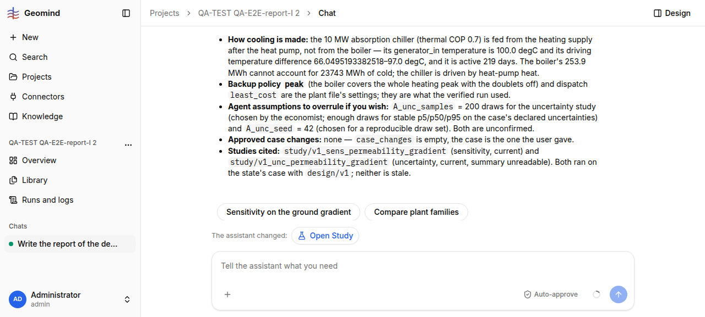

# QA-257: 'Write the report' chip: leads add an unrequested sensitivity and a 200-draw uncertainty study; the uncertainty summary is then unreadable (read_study 6x, result tools refuse), report says 'no number quoted'

| Field | Value |
|---|---|
| Status | verified |
| Severity | major |
| Area | geomind |
| Reporter | QA-E2E-report-I |
| Found | 2026-11-05 18:08 UTC |
| Versions | backend 1.1.109 (geomind 0.4.110), frontend bundle index-TsXgd_n9.js |
| Where | https://geomind.team/projects/fa329839-43df-48c3-81c3-89af503b92c0/assistant/chat; project QA-TEST QA-E2E-report-I 2; run d8662b0d-f79d-4245-a0c0-e5a52476a42d (17:45:35-18:02:43 UTC) |
| Fixer | hotfix-python-lead |

## Steps

1. Project with the reference case, plant v1 HackathonPlant, v2 HeatingAbsorptionCoolingPlant
   and a done page simulation of v1.
2. Click the chip "Write the report" (sends "Write the report of the design and its results.").

## Expected

A report of the existing design and result. Studies the user did not ask for are offered as
next steps (the chips "Sensitivity on the ground gradient", "Compare plant families" do this),
not run.

## Actual

- The project lead's brief to the analysis lead asks for "any sensitivity worth reporting ...
  (reservoir permeability and ground gradient uncertainty)"; the analysis lead's brief to the
  economist then asks for a one-at-a-time sensitivity on both drivers and "any uncertainty
  sampling (sample_uncertainty) you can run". The skill says "Uncertainty and sensitivity run
  only when the task asks", and the leads write the ask themselves.
- `sensitivity` ran (0.8 s, readable, reported). `sample_uncertainty` ran 200 draws, seed 42
  (52.8 s). Its summary was never readable: `read_study(study/v1_unc_permeability_gradient)`
  6 times (4 answered "same call as step N"), and the final report says "its per-metric summary
  (mean, p5, p50, p95 and the failed-draw count) — the stored study returns only an outline of
  its 200 samples ... and the result tools refuse its reference. No number from it is quoted
  here", and lists seed 42 / 200 draws as unconfirmed assumptions.
- Cost of the whole report: 17 min 8 s, 208 steps (17 retried), 3.11 M input tokens,
  0.065 USD; analysis lead + economist 17:49:58-17:54:23 (4.5 min).

Accuracy of the report itself (good): design/v1, result/9b0db55da13a4a5b, numbers equal the
page study of v1 (CAPEX 34.64 MEUR, OPEX 3.654 MEUR/yr, CO2 13.774 kt, 15/15 checks).

## Evidence

- 
- Run steps: `../evidence/QA-257/run-d8662b0d-steps.txt` (search sample_uncertainty, read_study)

## Cause

Fact: the briefs (project lead -> analysis lead -> economist) add the studies; no prompt rule
stops a lead from widening the user's request. Fact: `read_study` of a `sample_uncertainty`
study returns the outline of `samples` (200 items) and no per-metric statistics, and the agents
find no tool that summarises it.

## Fix

Proposal (geomind, hotfix-python):
1. Prompts `project/lead` and `analysis/lead`: a brief covers what the user asked; extra studies
   go into the finish suggestions, never into a brief.
2. `sample_uncertainty` / `read_study` return per-metric mean, p10/p50/p90 (or p5/p95) and the
   failed-draw count in the summary, so a sampled study is readable in one call.
- 2026-11-05 18:32 UTC: deployed by 19:22 CET: backend 1.1.115, geomind 0.4.123, gemini 0.6.21 (hotfix-python team)
## Retest

QA-E2E-report-I, 2026-11-05 19:30 UTC, project QA-TEST QA-E2E-report-I 3 (a9ff33c4), run 12115d92 (19:00:07-19:26:29 UTC), backend 1.1.122: no sensitivity or sample_uncertainty ran; the report says 'No uncertainty or sensitivity study was run' and the chips offer 'Sensitivity analysis'. Verified.
- 2026-11-05 19:28 UTC: retest run 12115d92: no unrequested studies
