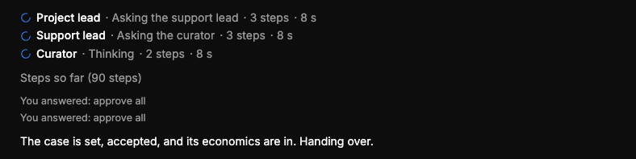

# QA-267: Chat busy list: the per-agent timers (e.g. '8 s') restart from 0 on every page reload; they count from when the page loaded, not from when the agent started

| Field | Value |
|---|---|
| Status | fixed |
| Severity | minor |
| Area | frontend,backend |
| Reporter | Sahand (screenshot), Manual QA-IV |
| Found | 2026-11-05 18:18 UTC |
| Versions | backend 1.1.114, frontend live 2026-11-05 18:17 UTC |
| Where | geomind.team chat busy list of a running run (Sahand's screenshot, 18:17 UTC) |
| Fixer | hotfix-front-lead |

## Steps

1. While a run works, the busy list shows each agent with a timer (Project lead · ... · 3 steps · 8 s).
2. Reload the page.

## Expected

Each timer shows the time since that agent started (or since its current step started), the same before and after a reload, from server timestamps.

## Actual

Every timer restarts from 0 s after a reload: the timers count from when the page received the agent, kept in the browser.

## Evidence

- 

## Cause

Guess: the busy list starts a local clock when it first sees an agent; `GET /assistant/runs/{id}/agents` gives no start time per session (fields: status, steps, llm_calls, tokens, cost, context, tool_calls), so the frontend has nothing to count from. Fix: the backend sends `started` (and the current step's start) per session; the frontend counts from it.

## Fix

frontend 1.1.126 (commit 7f06fdd, bundle index--MmxqmDW.js). Cause (fact): the backend already sends `ts` on step.started and step.finished, live and on replay (`callbacks.py` `public`, from geomind's event `time`), but the frontend event parser (`shared/sse/events.ts`) built step events without it, so `startedAt` always fell back to the browser clock at page load. The parser now keeps `ts`; each timer counts from the server time of the agent's first step. No backend change needed (a per-session `started` in /agents is not needed for this).
- 2026-11-05 18:23 UTC: frontend 1.1.126, commit 7f06fdd
## Retest
