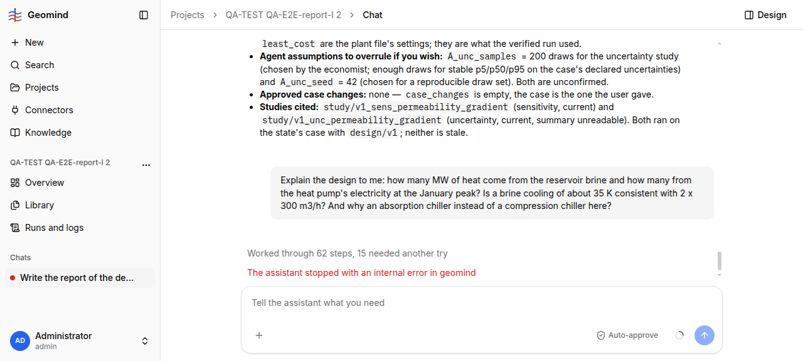

# QA-269: Design question in chat ends 'internal error in geomind' after 15 min, no answer: evaluate_module(heat_pump, result, time) refused 7x 'source_in: Stream.fluid: no value', the repeat guard kills the run

| Field | Value |
|---|---|
| Status | open |
| Severity | major |
| Area | geomind |
| Reporter | QA-E2E-report-I |
| Found | 2026-11-05 18:22 UTC |
| Versions | backend 1.1.109 (geomind 0.4.110), frontend bundle index-TsXgd_n9.js |
| Where | https://geomind.team/projects/fa329839-43df-48c3-81c3-89af503b92c0/assistant/chat; project QA-TEST QA-E2E-report-I 2; run 7bcc2a22-4ae0-4fb1-ab99-c53dfd54833e (18:05:14-18:19:55 UTC) |
| Fixer | |

## Steps

1. After the report of QA-257 (design/v1, result/9b0db55da13a4a5b in this chat), ask:
   "Explain the design to me: how many MW of heat come from the reservoir brine and how many from
   the heat pump's electricity at the January peak? Is a brine cooling of about 35 K consistent
   with 2 x 300 m3/h? And why an absorption chiller instead of a compression chiller here?"

## Expected

An explanation with numbers from the stored result in a few minutes. Hand check from the
result: brine heat per doublet = 300/3600 m3/s x 1030 kg/m3 x ~4.0 kJ/(kg K) x ~35 K ~ 12 MW,
~24 MW for both; heat pump electricity at the peak ~ 15 MW / COP 3.7-4.2 ~ 3.6-4.1 MW.

## Actual

- Routed to the analysis lead only (18 steps; no explainer). 34 read_result, 8 read_stored,
  4 calculate, then `evaluate_module {"name": "heat_pump", "time": "2027-01-28", "result":
  "result/9b0db55da13a4a5b"}` 7 times: 4x `invalid_call: heat_pump: inlet 'source_in':
  Stream.fluid: no value; expected a Fluid or a mapping of its fields`, 3x `failed_before`.
- Run ends `failed`, error `{"code": "error", "message": "evaluate_module: 2 invalid calls in
  a row"}`; the chat shows "The assistant stopped with an internal error in geomind" and no
  answer (screenshot 1). 14 min 41 s, 62 steps (15 retried), 0.81 M input tokens, 0.034 USD.
- The answer needed no evaluate_module: the result's series (hx, heat_pump, d0/d1 flows and
  temperatures) were readable with read_result.

## Evidence

- 
- evaluate_module, describe_module, list_modules calls with input and output: `../evidence/QA-269/evaluate-module-calls.json`
- Run steps: `../evidence/QA-269/run-7bcc2a22-steps.txt`

## Cause

Facts: (1) `evaluate_module` with `result` + `time` rebuilds the module's inlets from the stored
result without the stream's fluid (the same family as QA-149 "missing fluid", fixed for other
call forms); (2) the repeat guard turns 2 invalid calls in a row into a run error instead of a
refusal the lead can answer around; (3) the question went to analysis_lead, not the explainer.

## Fix

Proposal (geomind, hotfix-python): (1) `evaluate_module(result=, time=)` takes the inlet fluid
from the plant's fluids (`plant.fluids[...]`) when the stored stream has none; test it on
`heat_pump.source_in` of HackathonPlant; (2) the guard ends the tool, not the run: the agent
gets "stop calling evaluate_module, answer from read_result" and the lead finishes with what it
has; (3) project lead prompt: "explain/why" questions on a stored result go to the explainer.

## Retest

(Who, when, result.)
