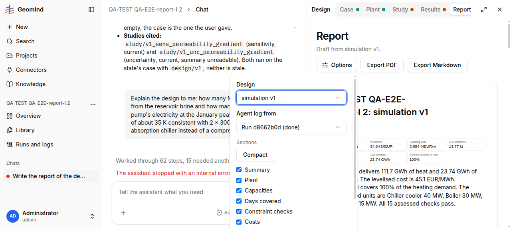

# QA-270: Report 'Geothermal covers 100% of the heating demand' for a plant whose 15 MW heat pump runs on grid electricity: the heat-pump electricity is counted as geothermal (geothermal = demand - boiler)

| Field | Value |
|---|---|
| Status | fixed |
| Severity | major |
| Area | backend |
| Reporter | QA-E2E-report-I |
| Found | 2026-11-05 18:30 UTC |
| Versions | backend 1.1.109 (geomind 0.4.110, gemini 0.6.17+), frontend bundle index-TsXgd_n9.js |
| Where | https://geomind.team/projects/fa329839-43df-48c3-81c3-89af503b92c0/design/report; project QA-TEST QA-E2E-report-I 2; result "simulation v1" (plant v1 HackathonPlant); same on project 1 result a528d8da |
| Fixer | hotfix-back-lead-II |

## Steps

1. Report page of a result of plant v1 HackathonPlant (doublets -> heat exchanger -> 15 MW heat
   pump -> 30 MW boiler; absorption chiller on the heating supply).
2. Read the Summary and Days covered.

## Expected

The geothermal share counts only the heat taken from the brine. Heat a heat pump adds with grid
electricity is not geothermal (or the report says "geothermal and heat pump"). The challenge
asks for the plant's energy balance; electricity bought for this plant is 26.73 GWh/yr
(vs 9.13 GWh/yr for v2 without a heat pump), most of it the heat pump.

## Actual

Summary: "Geothermal covers 100% of the heating demand." KPI tile "Geothermal share of heat"
(PDF) 100 %. Coverage data of result a528d8da: geothermal 111,413.8 MWh, backup 253.9 MWh of
111,667.7 MWh demand (99.8 %). The geothermal figure is demand minus boiler heat, so the
heat pump's electricity input (several MW at the peak, COP 3.67-4.17 in the run) is booked as
geothermal. For plant v2 (no heat pump) the same formula gives 39 %, so the two plants are
compared on an unequal basis.

## Evidence

- 
- Report page text: `../evidence/QA-270/report-page-text.txt`

## Cause

Fact: `backend/src/api/v1/reporting/design/narrative.py:144` `geothermal_share` sums
`coverage.heating[].geothermal`, which `gemini_study.stored_coverage` (backend
`src/api/v1/design/results/services.py:89`) fills as the non-backup heat. Guess: gemini's
coverage classes only "geothermal / backup / short" and has no heat-pump-electricity term.

## Fix

Backend 1.1.118 (d4ee0d2, back-m1) with gemini 0.6.22 coverage key `electricity`: the report splits heating into brine heat, heat-pump electricity and backup; older coverage is labelled 'geothermal with heat-pump electricity'.

Proposal: split the heating supply into brine heat, heat-pump electricity and boiler heat (from
the heat pump's `power_in` series and the boilers' heat), report "Geothermal (brine) x %, heat
pump electricity y %, boiler z %" in the Summary, the KPI tile, Days covered and the chart;
or, at least, call the share "geothermal and heat pump". Backend narrative/figures; the series
split may need a gemini coverage field (list it for Sahand if so).

- Note (QA-E2E-report-I, 2026-11-05 19:00 UTC): gemini already gives the split. In run 8efe3722 (project 2, case v4) the agents quote from `compute_kpis`: "geothermal_heat 95922 MWh (85.90 % of the heat delivered), heat_pump_electricity 15746 MWh, boiler_heat 0.0 MWh". On the same result the Report page still says "Geothermal covers 100%". So the backend can take `geothermal_heat` / `heat_pump_electricity` from the KPIs instead of demand minus boiler; no gemini request needed.
- 2026-11-05 18:59 UTC: deploy 36: backend 1.1.118, geomind 0.4.130, gemini 0.6.26 (hotfix-python-lead-II)
- 2026-11-05 19:02 UTC: backend 1.1.118 d4ee0d2
## Retest

A new simulation of a heat-pump plant: Report Summary and tiles give the heat-pump electricity share apart from geothermal.

QA-E2E-report-I, 2026-11-05 19:45 UTC, backend 1.1.122+, project QA-TEST QA-E2E-report-I 3, Report page of 'simulation HackathonPlant' (plant v1): Summary now says "Of the heating demand, geothermal brine heat 82 %, heat-pump electricity 18 %, backup 0.23 %." Check: heat-pump electricity 20,015 MWh / 111,668 MWh = 17.9 %, boiler 253.9 MWh = 0.23 %, brine the rest 81.9 %. Verified (`../evidence/QA-270/retest.png`).
