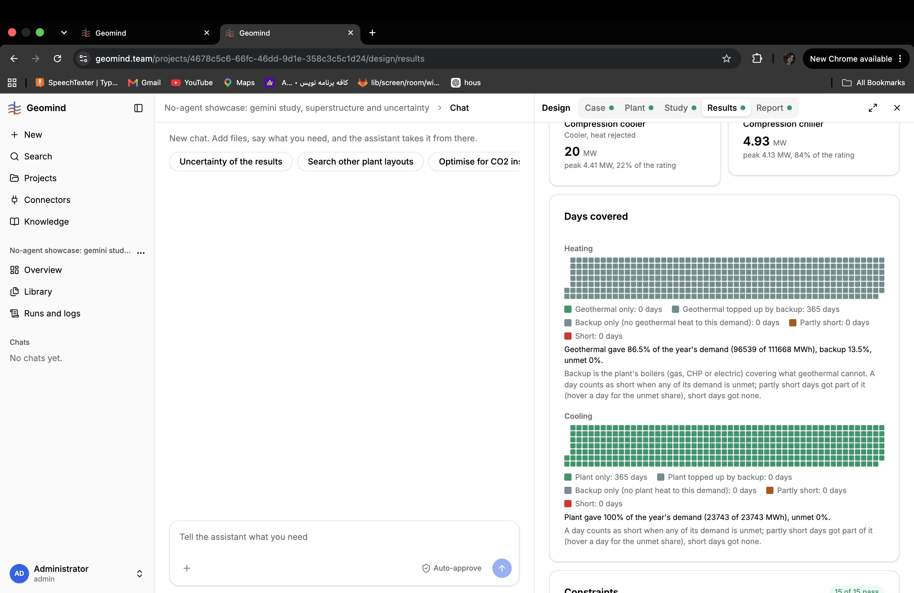

# QA-281: Days covered: the colours of 'Geothermal topped up by backup' and 'Backup only' are two greys that look the same; a day mostly geothermal cannot be told from a day the boiler did alone

| Field | Value |
|---|---|
| Status | fixed |
| Severity | minor |
| Area | frontend |
| Reporter | Sahand (screenshot), Manual QA-IV |
| Found | 2026-11-05 18:28 UTC |
| Versions | backend 1.1.115, frontend 1.1.126 |
| Where | https://geomind.team/projects/4678c5c6-66fc-46dd-9d1e-358c3c5c1d24/design (No-agent showcase) |
| Fixer | hotfix-front-lead |

## Steps

Open Results of a design whose boiler tops up the heat every day; look at Days covered, Heating.

## Expected

'Geothermal topped up by backup' and 'Backup only' in clearly different colours (for example a green-grey or hatched green for topped up, plain grey for backup only), so a 99 % geothermal day does not look like a boiler-only day (QA-126 asked the same).

## Actual

Both are greys of almost the same tone (legend squares side by side in the screenshot); all 365 days here are 'topped up', which reads as 'backup'.

## Evidence

- 

## Fix

frontend 1.1.127 (commit 1fdd120, bundle index-DnQKqly3.js), by front-m1: topped-up days are diagonal stripes (mostly --ok, thin --gas), backup only stays plain --gas; legend uses the same stripes.
- 2026-11-05 18:39 UTC: frontend 1.1.127
## Retest
