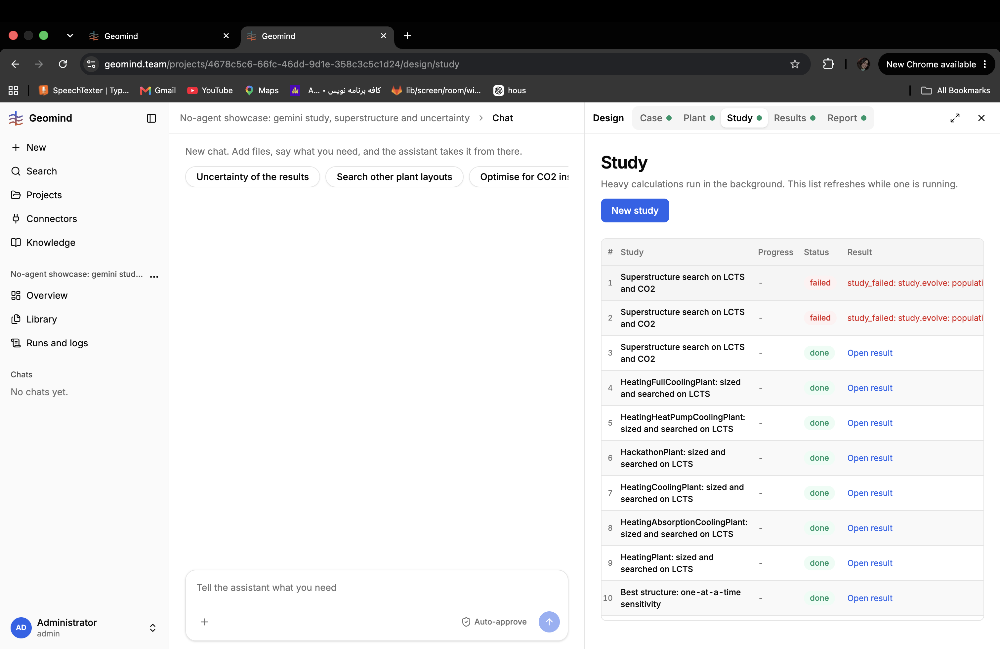

# QA-282: Study form/API accepts evolve settings that cannot run (polish > 0 with population 16: 'polish searches with minimize, which needs at least 5 per variable'); the study is created and fails at once instead of being refused at creation

| Field | Value |
|---|---|
| Status | open |
| Severity | minor |
| Area | backend |
| Reporter | Manual QA-IV |
| Found | 2026-11-05 18:28 UTC |
| Versions | frontend <x.y.z>, backend <x.y.z> (geomind <x.y.z>) |
| Where | <URL>; project <name/id>; chat <id>; run <id>; step <n> |
| Fixer | |

## Steps

1. 
2. 

## Expected

## Actual

## Evidence

- 
- Run JSON: `../evidence/QA-282/run-<id>.json`

## Cause

(Facts, or a guess marked as one.)

## Fix

(Hotfix session: cause, commit, version, deployed at.)

## Retest

(Who, when, result.)
